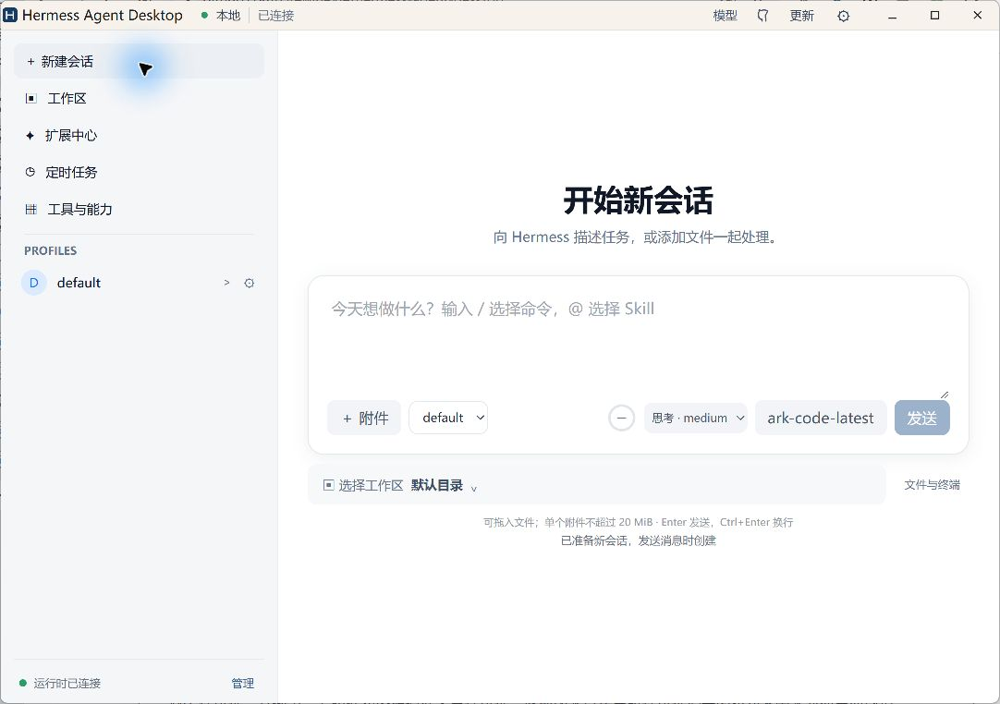
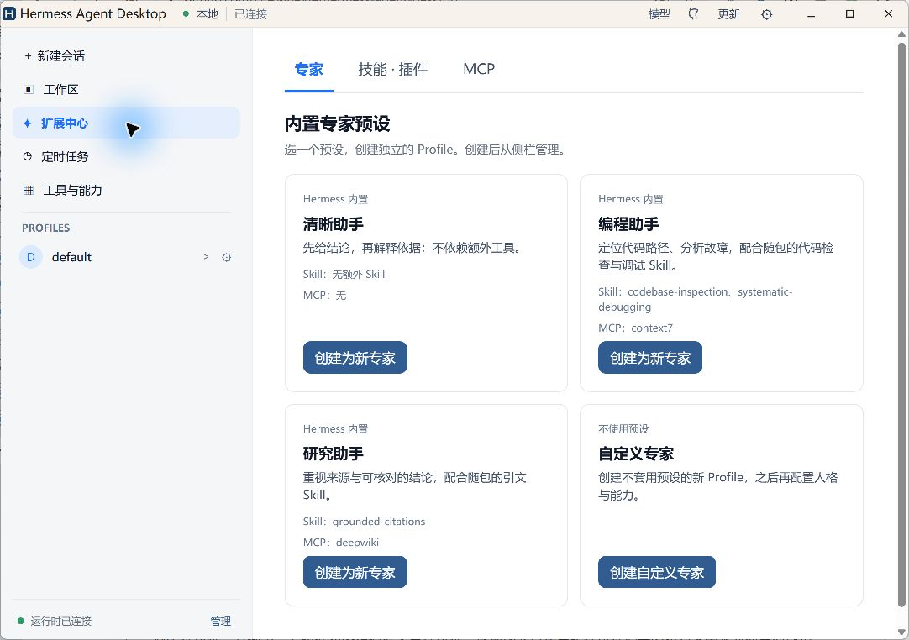

# Hermess Agent Desktop

Hermess Agent Desktop 是基于 [Hermes Agent](https://github.com/NousResearch/hermes-agent) 的中文桌面 AI 助手。它把聊天、文件工作区、独立的专家 Profile、Skill/MCP 扩展、工具和定时任务放在一个窗口中；用户可连接自己的模型，客户端负责管理独立的本地 Hermes Gateway 和数据目录。

首个正式版 **v0.1.6** 的安装包与校验清单见 [Release 页面](https://github.com/FirewineXie/hermess-agent-desktop/releases/tag/v0.1.6)。同版本重新发行后，请重新核对下载文件的 SHA-256；可下载平台以 Release 附件为准。安装、升级与真实模型的验证范围见下方路线图。

## 产品截图

以下截图取自 Windows 0.1.6 客户端，展示新会话和内置专家预设界面。

| 新会话 | 扩展中心 · 专家预设 |
| --- | --- |
|  |  |

**[查看产品路线图（ROADMAP）](ROADMAP.md)**：按版本查看功能、验证状态和后续计划。`v0.1.6` 的可下载平台以 Release 附件为准；macOS 原生安装、Linux 安装包及 0.1.5 → 0.1.6 覆盖安装仍待验收。

**[前端与桌面客户端架构演进方案](docs/architecture-frontend-desktop.md)**：目标项目边界、View 与组件拆分、客户端模块、接口契约和迁移验收。方案正在分阶段实施，当前开发与构建命令仍以本 README 为准。

工作区项目：[前端](apps/frontend/README.md)、[桌面客户端](apps/desktop/README.md)、[接口契约](packages/contracts/README.md)。三个项目的当前实现状态以各自 README 为准。

## 当前能力

- 中文聊天界面、模型配置、流式回复、会话历史、停止、审批与澄清。
- 工作区页可保存本地文件夹快捷入口，并在选定目录中新建 Hermes 会话；已有会话恢复时沿用原工作目录。
- 本地文件和图片附件，含原生选择、拖入及短文本预览。
- 独立数据根、固定上游提交、运行时归档校验与首次解包。
- 按正式或预发布版本 tag 默认构建 Windows x64 与 macOS Apple Silicon 安装包并汇总到 Release；macOS Intel 与 Linux x64 可按需为同一 tag 补发。
- 「关于」页展示产品与锁定上游版本、两份离线许可证及工具来源；软件更新页可保存正式版或 RC 渠道偏好，并从公开的 GitHub Release 检查、校验和下载适用安装包。下载后仍需手动运行安装程序。
- 「渠道接入」页提供飞书和微信二维码授权；桌面使用一个自有 Hermes 网关进程承载聊天与消息渠道。关闭窗口时收起到系统托盘，托盘菜单可恢复窗口或退出。

这些能力在各平台的验证层次不同。当前的 Windows 假模型和静默安装结果不代表原生窗口或真实模型已通过验收，详见 [能力矩阵](docs/capability-matrix.md)。

## 本地开发

参与开发的分支、提交、验证和 PR 约束见 [CONTRIBUTING.md](CONTRIBUTING.md)。

产品功能与版本进度见 [路线图](ROADMAP.md)。**每次开发完成后，提交或提出 PR 前必须更新路线图中对应版本的内容**：记录本次新增或修复的功能、当前状态、实际验证范围及未完成项；发布 tag 后再标记为已发布。不能把开发分支或构建通过写成发布或实机验收。

### 按版本开发

每次开始开发前，先检查当前工作区的 `git status`、当前分支、已有工作区和本地/远端版本分支，并获取最新的 `origin/main`。确定本次计划发布的版本号（例如 `v0.1.5`）后：

1. 如果 `feature/v0.1.5` 已存在，就在该分支继续开发；若它已由另一个工作区检出，则使用那个工作区。保留所有未提交改动，不强行切换或重建分支。
2. 如果本地没有该分支，但远端已有，先检出并跟踪远端分支；如果本地和远端都没有，才从最新的 `origin/main` 创建 `feature/v0.1.5`。
3. 开发期间如 `main` 有新的修复，将其同步到版本分支并重新验证。候选版可在版本分支的已提交且完成本地检查的提交上创建 RC tag（如 `v0.1.5-rc.1`），核对发行输入后推送。版本完成后通过 PR 合入 `main`；PR 检查及合并要求见 [贡献流程](CONTRIBUTING.md)。合并后的 `main` 通过 CI、版本文件和发布资源核对后，再创建正式版 tag `v0.1.5`。

紧急修复从最新的 `origin/main` 创建独立的 `fix/...` 分支，验证后通过 PR 合入 `main`，并将修复同步到仍在开发的版本分支。`feature/v0.1.5` 是可继续提交的开发分支；`v0.1.5-rc.1` 是候选版 tag，`v0.1.5` 是正式版 tag。若无法从计划确定下一个版本号，先明确版本号，不凭现有 tag 猜测。

```sh
git clone https://github.com/FirewineXie/hermess-agent-desktop.git
cd hermess-agent-desktop
pnpm setup:hooks
pnpm fetch:upstream
pnpm install --frozen-lockfile
pnpm verify:upstream
pnpm build
```

原生构建需 Node 24、pnpm 10.25、Rust 1.94、CPython 3.14 及对应系统的 Tauri 依赖。开发态启动可运行 `pnpm tauri:dev`；完整离线候选包需先按 [发行流程](docs/release-process.md) 准备固定上游运行时。

日常操作可在仓库根目录使用下面五个命令；先在目标系统执行一次 `pnpm deps`，后续可直接运行或打包。`pnpm deps` 获取锁定上游、安装前端与 Rust 依赖，并准备开发环境及完整离线载荷；已有载荷会重新校验，不会被覆盖。原生工具链及 Linux Tauri 系统库仍需按系统安装。

| 命令 | 作用 |
| --- | --- |
| `pnpm deps` | 下载并准备当前系统的依赖与离线载荷 |
| `pnpm start` | 在 Windows 或 macOS 启动桌面开发版 |
| `pnpm pack:win` | 在 Windows x64 生成 NSIS `.exe` |
| `pnpm pack:mac` | 在 macOS Apple Silicon 或 Intel 生成 `.dmg` |
| `pnpm pack:linux` | 在 Linux x64 生成 `.AppImage` 和 `.deb` |

安装包输出到 `apps/desktop/src-tauri/target/release/bundle/` 下对应格式的目录。打包命令按当前操作系统检查目标平台，不执行跨平台交叉编译；macOS 本地包使用临时签名，正式发布仍须遵循发行流程。若机器上的 CPython 3.14 没有常用命令名，可通过 `HERMESS_PYTHON` 指定其绝对路径。`pnpm start` 是开发窗口，不代表安装包验收。

Hermes fork 桌面分支的 SHA 锁定与官方 Release 升级步骤见 [源码流程](docs/upstream-source.md)。

## 版本构建

推送正式 tag `v主版本.次版本.修订号` 或预发布 tag（例如 `v0.1.5-rc.1`）会触发 `.github/workflows/tagged-release.yml`。tag 必须与根包、桌面包、Cargo 和 Tauri 的版本一致，并包含 `releases/<tag>.md` 的版本说明。先用 `.github/workflows/warm-release-cache.yml` 在 `main` 预热对应平台的原生依赖缓存；缓存缺失时发布构建会失败，不在发布任务中下载 Python/uv 依赖。Windows x64 和 macOS Apple Silicon 构建成功后建立带两个安装包和 SHA-256 文件的 Release；macOS Intel、Linux x64 可用 `.github/workflows/optional-release.yml` 按需补发并更新清单。具体步骤见 [发行流程](docs/release-process.md)。

## 许可

本项目由 Firewine 享有著作权的原创代码和文档采用 [PolyForm Strict 1.0.0](LICENSE)：允许非商业使用，包括安装和运行桌面软件；修改、制作衍生作品、分发或商业使用，均须事先取得 Firewine 的书面授权。详见[版权与使用说明](COPYRIGHT.md)。`upstream/hermes-agent` 由 `pnpm fetch:upstream` 按锁定 Release tag 单独克隆，不纳入产品仓库，仍遵循上游自己的 MIT 许可证。其他第三方组件和资源遵循各自许可证。此前版本已按当时许可证授予的权利不因本次变更而撤销。

## 安全问题

发现安全漏洞请按 [安全问题报告说明](SECURITY.md) 私密提交；普通使用问题可通过 [Issues](https://github.com/FirewineXie/hermess-agent-desktop/issues) 反馈。
