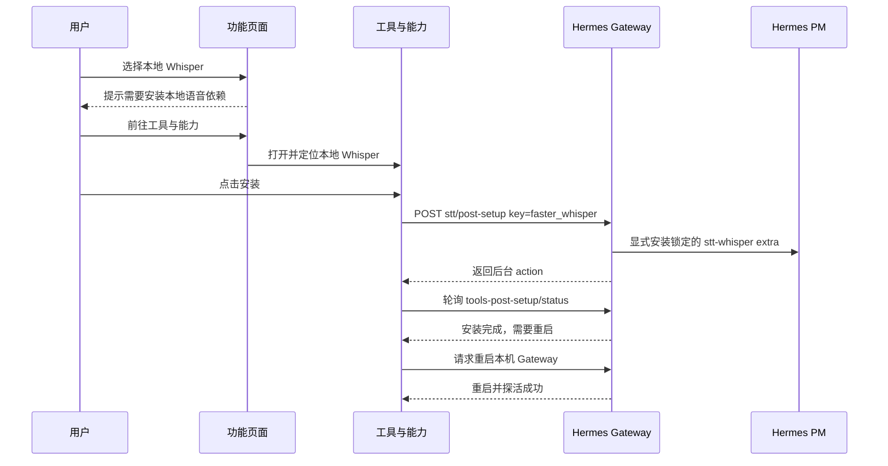
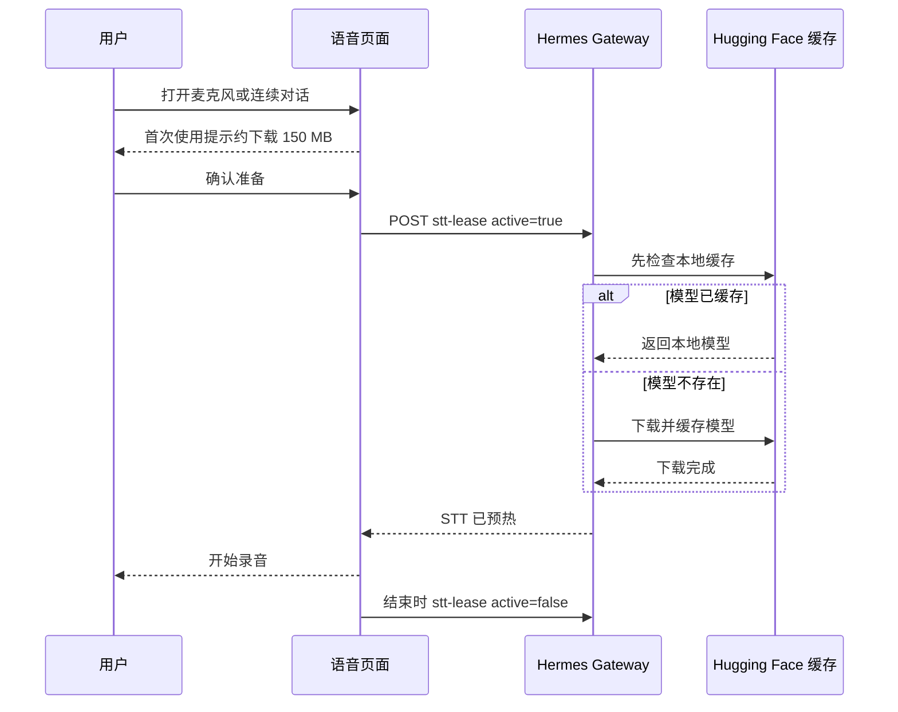

# Hermess Desktop 复用 Hermes Desktop 按需安装方案

状态：方案草案，待审核后实施。

本文定义 Hermess Desktop 初版如何缩小默认安装内容，并复用上游 Hermes Desktop 已有的按需安装与首次预热流程。核心原则是：不建设新的通用能力包系统，不拆当前已经进入 `venv` 的 Python 依赖，所有可选功能统一在“工具与能力”页面展示；缺少依赖时执行 Hermes 的 `post-setup`，需要模型或声音资源时执行 Hermes 的 `lease` 首次预热。

核心结论：初版只接入 Hermes 已有的两类操作，不开发新的下载器、模型包管理器、Python generation 管理器或离线修复包。

## 1. 已核实的现状

### 1.1 当前载荷体积

当前工作区 `.build/payload` 在 2026-10-28 的解压体积如下。该数字是开发载荷的原始磁盘占用，不是安装程序压缩后的下载量：

| 目录 | 解压体积 |
| --- | ---: |
| `venv` | 294.0 MiB |
| `uv-cache` | 199.0 MiB |
| `tools` | 181.8 MiB |
| `hermes-agent` | 135.3 MiB |
| `pm-runtime` | 2.0 MiB |

最终收益必须通过重新生成 Windows 和 macOS 安装包验证，不能直接把解压目录减少量当成安装包减少量。

### 1.2 当前 Python 环境

`scripts/build-core-payload.py` 当前显式构建：

```text
messaging
feishu
```

因此当前渠道相关依赖已经进入 `venv`。当前实测环境没有：

```text
faster_whisper
ctranslate2
huggingface_hub
```

初版不把已经存在的 `messaging`、`feishu`、`lark-oapi`、微信复用的渠道基础依赖、文档依赖和其他现有 Python 包移出 `venv`。

### 1.3 当前客户端能力

客户端已经具备：

- `GET /api/audio/voice-config`；
- `POST /api/audio/transcribe`；
- `POST /api/audio/speak`；
- `list_downloadable_tools`；
- `install_downloadable_tool`；
- 工具安装互斥、超时、日志和安装后复核；
- “工具与能力”页面及 Gateway 重启入口。

当前客户端尚未接入：

- `POST /api/tools/toolsets/{name}/post-setup`；
- `GET /api/actions/tools-post-setup/status`；
- `POST /api/audio/stt-lease`；
- `POST /api/audio/tts-lease`。

### 1.4 Hermes Desktop 的现有做法

Hermes Desktop 已经提供两类可复用操作。

第一类是 `post-setup`：

```http
POST /api/tools/toolsets/{name}/post-setup
```

它用于安装一个提供方需要的 Python extra、二进制程序或其他前置资源。后台通过受限的 `post_setup` key 执行固定安装逻辑，并通过 `tools-post-setup` action 返回状态和日志。

例如本地 Whisper：

```text
toolset: stt
post_setup key: faster_whisper
内部操作: pm.sync_venv(["stt-whisper"], explicit=True)
```

`explicit=True` 表示这是用户明确触发的安装，不依赖自动懒安装。当前 Gateway 继续设置 `HERMES_DISABLE_LAZY_INSTALLS=1`，避免功能调用在用户不知情时修改依赖环境。

第二类是 `lease` 首次预热：

```http
POST /api/audio/stt-lease
POST /api/audio/tts-lease
```

`active: true` 表示用户即将使用语音能力。Gateway 在这个阶段加载本地引擎；模型或声音资源不存在时，由 Hermes 原有实现下载、缓存并加载。`active: false` 释放当前使用租约，但不删除已缓存资源。

Hermes Desktop 的 bundled 运行时是不可变资源。运行时文件损坏时要求重新安装应用，不在桌面端维护一个独立离线修复包。

## 2. 初版决策

### 2.1 现有 venv 不拆

初版不做以下工作：

- 不把渠道依赖移出 `venv`；
- 不重构现有核心 Python extras；
- 不开发 Python generation 切换逻辑；
- 不开发 Python extra 卸载；
- 不允许前端提交任意 extra、pip 包名或命令。

需要新增 Python 提供方时，只调用 Hermes 已有的 `post-setup` 白名单入口。环境构建、固定版本、失败处理和重启要求由 Hermes PM 负责。

### 2.2 工具与能力统一展示

“工具与能力”是唯一安装入口。语音、浏览器、文档、渠道等业务页面只做：

1. 查询功能是否就绪；
2. 已就绪时继续使用；
3. 未就绪时说明原因；
4. 跳转并定位“工具与能力”中的对应项目。

业务页面不得自行实现下载器、安装日志、重启、模型缓存或失败重试。

### 2.3 只使用两类功能安装操作

所有需要额外资源的功能按下面两步组合，不再建立通用 `installCapability` 系统。

#### 操作一：Post setup

用途：安装提供方运行所需的 Python extra、二进制工具或前置资源。

客户端只传 Hermes 已声明的 toolset 和 `post_setup` key。Gateway 必须执行现有白名单校验，客户端不得传任意命令。

用户界面状态：

```text
需要安装
安装中
需要重启
已就绪
安装失败
```

#### 操作二：Lease 首次预热

用途：在用户即将使用功能时下载并加载模型、声音或其他首次使用资源。

首版不建设下载百分比协议。请求执行期间显示：

```text
正在准备本地语音，首次使用可能需要下载资源
```

成功后显示“已就绪”，失败时显示 Hermes 返回的可读错误和重试入口。不能伪造百分比。

### 2.4 独立工具继续复用 Hermes PM

FFmpeg、Git、Chromium、agent-browser、cua-driver 等独立程序继续使用 Hermes PM 的固定清单和摘要校验。

功能提供方已经声明 `post_setup` 时，客户端优先调用 `post-setup`，由 Hermes 组合安装其内部工具。没有 provider `post_setup`、但属于现有工具目录的程序，可以继续使用当前 `install_downloadable_tool`。这是同一个 Hermes PM 安装底座，不新增第三套包管理系统。

### 2.5 不提供离线修复包

初版不提供 `offline-repair` 下载项。

`uv-cache` 继续作为构建缓存使用，但从最终发布载荷移出。移出后：

- 正常运行使用已经构建完成的密封环境；
- 用户明确执行 `post-setup` 时允许联网获取锁定依赖；
- 密封运行时缺失或损坏时提示重新安装 Hermess Desktop；
- 无网络时不承诺重建损坏的密封运行时。

该决策预计减少约 199.0 MiB 的解压载荷，最终安装包减少量必须实测。

## 3. 功能映射

### 3.1 消息渠道

飞书、微信和当前渠道基础依赖已经在 `venv`，初版显示为“随应用提供”，不提供下载按钮。

渠道账号仍分别配置。飞书、微信、Telegram、Discord、Slack 不拆成独立安装包，也不新增 `channels` 包。

### 3.2 本地 STT

本地 Whisper 使用两步流程：

```text
post-setup: toolset=stt, key=faster_whisper
lease: POST /api/audio/stt-lease
```

默认模型是 `base`。首次 `stt-lease active=true` 时：

1. Hermes 先用 `local_files_only=True` 检查 Hugging Face 本地缓存；
2. 命中缓存时直接加载；
3. 未命中时通过 `faster-whisper` 和 `huggingface_hub` 下载；
4. 下载完成后加载模型；
5. 后续使用复用缓存。

Hermes 现有提示估算 `base` 模型首次下载约 150 MB。该数字用于下载前提示，不作为精确进度总量。

### 3.3 Windows ARM64 Whisper cpp

Windows ARM64 使用 Hermes 已有 `whispercpp-cpu` 工具和首次模型准备逻辑。第一次转写时下载：

- `ggml-base.bin`；
- `ggml-silero-v6.2.0.bin`。

Hermes 原有下载器负责断点续传、并发锁、SHA-256 校验和原子发布，资源存放在：

```text
<HERMES_HOME>/cache/whisper.cpp/
```

客户端不复制这套实现。

### 3.4 本地 TTS

Piper 和 KittenTTS 使用 Hermes 已有 TTS 提供方流程：

```text
post-setup: toolset=tts, key=piper 或 kittentts
lease: POST /api/audio/tts-lease
```

Piper 的声音资源在首次 TTS 预热或调用时由 Hermes 下载。客户端只展示准备状态和错误，不直接管理音色文件。

Edge TTS 是在线服务，不下载本地模型；云端 OpenAI、xAI、ElevenLabs、Mistral 等 STT/TTS 也不下载本地模型。

### 3.5 浏览器和计算机控制

优先使用 Hermes 已有 provider `post_setup`：

```text
agent_browser
cua_driver
```

Hermes 负责安装对应的 Chromium、agent-browser、cua-driver 或相关依赖。当前已有的独立 PM 工具安装入口继续作为目录展示和兼容路径，不再设计 `browser-automation` 能力包。

### 3.6 文档和媒体

当前已经进入 `venv` 的文档依赖保持不动。FFmpeg 等独立程序继续通过现有 PM 工具安装入口下载。

初版不新增 `document-media` 包，也不把文档 Python 依赖从核心环境移出。

## 4. 用户流程

### 4.1 安装提供方依赖



### 4.2 首次下载模型



### 4.3 已安装后的再次使用

再次打开麦克风时仍发送 `stt-lease active=true`。Hermes 会命中缓存或已加载模型，客户端不能用自己的时间戳猜测模型是否仍驻留内存。

### 4.4 失败处理

- `post-setup` 失败：保留当前运行环境，展示 action 日志摘要和重试；
- Gateway 重启失败：回到运行时页面处理，不把提供方标记为可用；
- 模型下载失败：不开始转写，显示网络或 Hugging Face 错误；
- 用户取消使用：发送 `lease active=false`；
- 远程 Gateway：不允许桌面端擅自安装远程依赖，只展示远端状态和管理员指引。

## 5. 客户端改动

### 5.1 前端

扩展现有 `apps/frontend/src/features/tools/`：

- 展示 Hermes toolset provider 的 readiness；
- 调用 `post-setup`；
- 轮询 `tools-post-setup` action；
- 安装完成后复用现有 Gateway 重启；
- 支持功能页跳转并定位具体提供方；
- 不新增第二个能力管理页面。

语音控制器增加 STT/TTS lease 生命周期：

- 打开本地语音前 acquire；
- acquire 完成后再提交录音；
- 停止、切换连接、切换 Profile 或组件销毁时 release；
- 云端 STT/TTS 不获取本地 lease。

### 5.2 桌面适配层

增加窄接口，不增加通用安装命令：

```text
runToolsetPostSetup(toolset, key, profile)
getToolsPostSetupStatus(profile)
setSttLease(lease, active, profile)
setTtsLease(lease, active, profile)
```

这些接口只转发到 Hermes 已有 HTTP API。前端不得提交 shell 命令、pip 包名、URL 或任意 extra 名称。

### 5.3 Rust 宿主

Rust 宿主继续负责连接归属、Profile 作用域、本机 Gateway 重启和凭据隔离。它不实现 Whisper、Piper 或 Hugging Face 下载器。

如果现有 Gateway HTTP 客户端可以安全转发上述请求，则直接扩展适配接口；不新增 `capabilities.rs`、模型数据库或下载任务管理器。

### 5.4 构建脚本

`scripts/build-core-payload.py` 保持当前 extras，不拆 `venv`。构建阶段仍可使用 `.cache` 下的 uv 依赖缓存，但最终 payload 不再保留 `uv-cache`。

相应调整：

- payload 清单；
- `scripts/verify-payload.py`；
- 构建缓存复用路径；
- 移除“成品必须完全离线重建”的验收要求；
- 保留密封环境正常启动和文字聊天回归；
- 增加联网 `post-setup` 安装和重启验收。

## 6. 收敛需求

以下需求使用 EARS 风格描述实施边界。

### 6.1 安装

- 当功能依赖缺失时，功能页面应提示并跳转到“工具与能力”，不得自行安装。
- 当用户在“工具与能力”明确点击安装时，客户端应调用 Hermes 声明的 `post-setup`，不得提交任意命令或包名。
- 当 `post-setup` 尚未完成时，客户端不得把提供方显示为已就绪。
- 当 `post-setup` 要求重启时，客户端应在重启并探活成功后重新读取 readiness。
- 当当前连接是远程 Gateway 时，客户端不得自动修改远程依赖环境。

### 6.2 首次资源准备

- 当用户第一次使用本地 STT/TTS 时，客户端应在取得用户确认后获取对应 lease。
- 当模型已经缓存时，Hermes 应复用缓存，不得重复下载。
- 当模型未缓存时，客户端应等待 Hermes 完成下载和加载后再提交音频。
- 当 lease 准备失败时，客户端不得假装本地语音可用，也不得静默切换到云端提供方。
- 当用户停止使用、切换连接或切换 Profile 时，客户端应释放原 owner 的 lease。

### 6.3 下载与安全

- 当 Hermes 已有下载器负责资源时，客户端不得复制一套下载、摘要或缓存实现。
- 当下载没有精确进度事件时，客户端应显示不确定进度，不得伪造百分比。
- 当日志包含外部进程输出时，客户端不得显示或持久化 API Key、令牌和完整环境变量。
- 当另一个 `post-setup` 正在执行时，客户端应复用或等待现有 action，不得并发启动相同安装。

### 6.4 密封运行时

- 当密封运行时正常时，客户端应直接使用，不得执行后台修复下载。
- 当密封运行时缺失或损坏时，客户端应提示重新安装应用，不得声称能够离线修复。
- 当最终 payload 不包含 `uv-cache` 时，发布说明应明确不再提供完全离线依赖重建。

## 7. 分阶段实施

### 阶段一：接入本地 Whisper

1. 接入 STT toolset readiness。
2. 接入 `stt/faster_whisper` post-setup。
3. 接入 action 状态和日志摘要。
4. 安装完成后重启 Gateway 并重新探测。
5. 在手动录音和连续对话中接入 `stt-lease`。
6. 验证首次下载、缓存复用、失败重试和 Profile 切换。

交付物：用户可以通过 Hermes 原有流程安装 faster-whisper，并在首次录音前下载和预热默认模型。

### 阶段二：接入 TTS 和浏览器提供方

1. 接入 `tts/piper`、`tts/kittentts` post-setup。
2. 接入 `tts-lease`。
3. 接入 `browser/agent_browser` 和计算机控制 provider post-setup。
4. 保留现有独立工具 PM 安装作为兼容路径。

交付物：本地 TTS 和浏览器提供方使用与 Hermes Desktop 相同的准备流程。

### 阶段三：移除成品 uv cache

1. 将 uv 缓存保留在构建缓存目录。
2. 从最终 payload 移除 `uv-cache`。
3. 更新 payload 校验和运行时错误提示。
4. 验证全新安装、升级、文字聊天、渠道、Profile 和联网 post-setup。
5. 实测压缩安装包和安装后占用变化。

交付物：不引入离线修复系统的前提下减少默认安装体积。

## 8. 验收标准

### 8.1 本地 Whisper

- 当前环境缺少 faster-whisper 时，“工具与能力”显示需要安装。
- 用户未点击安装时不执行 post-setup。
- post-setup 使用固定 `faster_whisper` key，任意 key 被拒绝。
- 安装完成但未重启时不显示为完全可用。
- 首次 acquire STT lease 下载并加载默认模型。
- 第二次 acquire 命中缓存，不重复下载完整模型。
- 真实麦克风录音可以转写。
- 下载失败、断网和 Profile 切换不会错误标记成功。

### 8.2 TTS 和其他提供方

- Piper 或 KittenTTS 缺失时只通过 provider post-setup 安装。
- 首次 TTS lease 完成声音资源准备后才能播放。
- 云端 STT/TTS 不触发本地 post-setup 或 lease。
- 浏览器提供方复用 Hermes post-setup，不新增客户端安装器。

### 8.3 安装包和运行时

- 当前 `venv` 已有渠道和文档功能保持可用。
- 最终 payload 不包含 `uv-cache`，构建缓存仍可复用。
- Windows 和 macOS 安装包有优化前后实测数据。
- 密封运行时损坏时提示重装，不出现不存在的离线修复按钮。
- 核心文字聊天、Profile、会话、模型配置和渠道回归通过。

## 9. 明确不做

初版不做：

- 通用能力包清单和 `installCapability`；
- 自研 Whisper、Piper 或 Hugging Face 下载器；
- 单独的模型商城和模型包管理；
- 渠道拆包；
- 现有 `venv` 依赖瘦身；
- 离线修复包；
- 任意 pip、命令、URL 或 extra 安装；
- 远程 Gateway 自动安装；
- 没有后端事件支撑的虚假下载百分比。

## 10. 最终实施边界

初版只增加客户端到 Hermes 现有 `post-setup` 和 `lease` 的接入，并复用现有工具页面、Gateway 重启和 Hermes PM。已有 Python 环境保持不动；模型和声音资源由 Hermes 在用户明确使用时下载；`uv-cache` 只留在构建侧；密封运行时损坏时重新安装应用。

该边界把改动集中在少量 API 适配、工具页面状态和语音生命周期，不再建设独立包管理平台。
