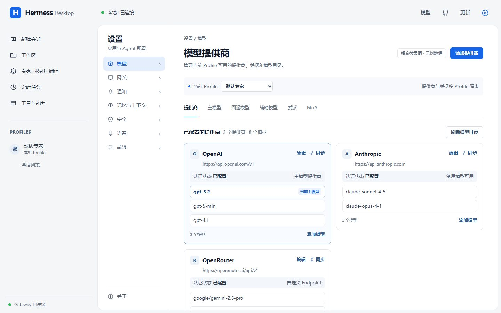
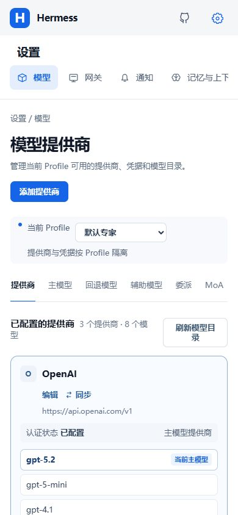
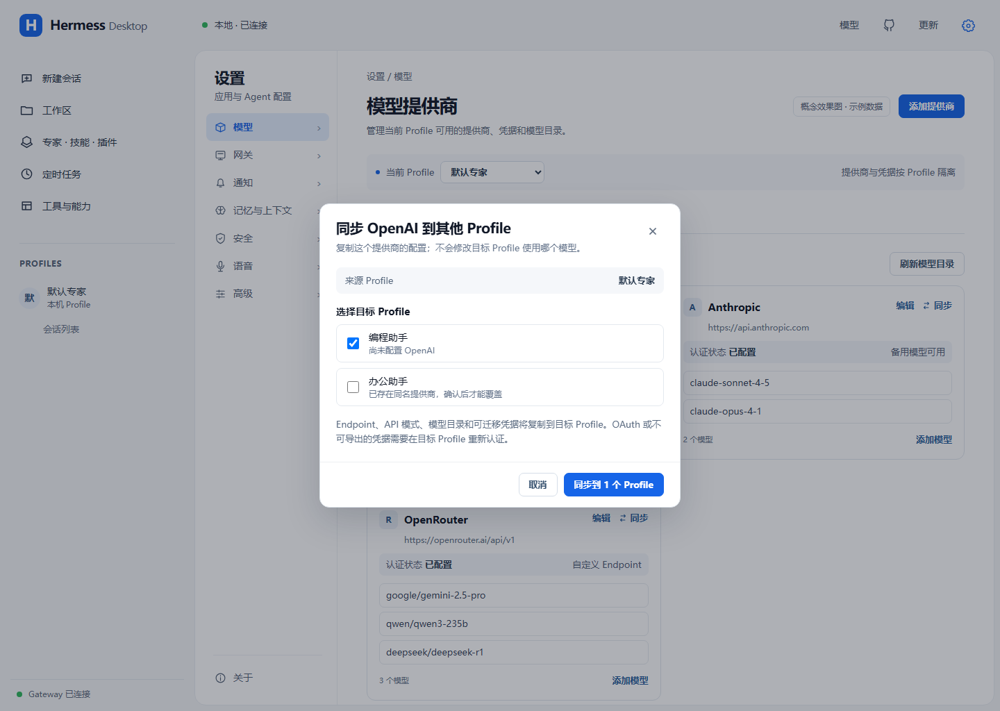

# Hermes 桌面设置功能迁移方案

状态：实施中。实际完成度、代码证据、验证结果与阻塞项见 [设置功能迁移验收记录](settings-feature-migration-progress.md)。范围：在当前客户端的统一设置入口中放入模型、网关、通知、记忆与上下文、安全、语音、高级七组设置；功能项、字段、规则和行为全部以锁定的 Hermes 云端功能基线为依据同步，并接通使设置实际生效的客户端能力。

## 1. 基线、目标与判定方法

本方案以上游锁文件 `runtime/upstream.lock.json` 中的 fork 提交 `882037eb8745b505db438217513c4c94f95c93c1` 为功能基线，官方基线为 `v0.22.5`。下文的“上游”均指本地忽略目录 `upstream/hermes-agent/` 中该提交的 `apps/desktop/` 客户端与对应 Hermes 接口，不指上游仓库未来版本。实施前运行 `pnpm verify:upstream`，若锁定提交变化，须重新核对清单。

### 1.1 云端功能同步原则

本文所称“云端功能”是产品维护的 Hermes fork 云端代码在上述锁定提交中的可复现功能快照；本地 `upstream/hermes-agent/` 只是该快照的核对副本。不得在开发过程中直接追随云端分支浮动 HEAD。需要同步锁定提交之后的新功能时，先按仓库的上游升级流程更新锁文件并重新审核，再修改本方案和产品代码。

七组设置内的功能全部按云端实现同步，不自行删减成只有同名输入框的近似版本。每项至少同步以下语义：

1. 设置分类、子页、字段名称、说明、默认值、单位、选项顺序和搜索定位。
2. 显示、隐藏、只读、禁用及依赖其他字段或宿主能力的条件。
3. Profile、连接、设备和会话作用范围，以及读取、保存、重读、重启和新会话生效边界。
4. 配置键、HTTP/RPC 接口、请求结构、Schema 校验、确认流程、冲突处理和后端拒绝语义。
5. 加载、空态、失败、部分可用、需要重新认证、需要重启和版本不匹配等用户可见状态。
6. 实际功能路径，包括模型调用、回退、压缩、审批、通知、语音和连接；不能用“配置保存成功”代替功能生效。

同步目标是**功能与行为一致**，不是复制云端 Electron 实现。当前产品继续使用 React + Tauri 的所有权链路，将云端 Electron IPC、窗口、进程、通知、音频和凭据行为转换为产品契约及平台适配。云端存在但当前 Tauri、锁定 Gateway 或操作系统暂不支持的能力，必须显示为不可用或暂不放出，并记录阻塞证据；不得提供无实际作用的开关。

允许的产品差异只有三类：已确认的统一设置壳层与视觉适配；Windows/macOS 所需的平台适配；文档明确标注的 Hermess Desktop 产品增强，例如“提供商同步到其他 Profile”。每个差异都必须在功能对照表中标记为“界面适配”“平台适配”或“产品增强”，不能混写成云端原生功能。

迁移完成的判定不是“出现同名设置项”，而是设置能正确读取、保存、重新读取、作用于预期范围，并通过真实功能路径验证。每项记录四种范围之一：设备本地、连接、Profile、会话。不得把 Profile 配置误存为设备偏好，也不得把外部网关当成本产品创建的进程。

代码所有权沿用现有链路：`apps/frontend` 的功能界面和控制器 → `packages/contracts` 的具名能力 → `apps/desktop/src/adapter/tauriDesktopApi.ts` → `apps/desktop/src-tauri/src` 的 Rust 适配 → 锁定 Hermes Gateway 或操作系统。上游 Electron 的 `window.hermesDesktop`、IPC 和进程实现只能作为行为对照，不能直接放入 Tauri 前端。

**证据入口：**上游设置入口 `upstream/hermes-agent/apps/desktop/src/app/settings/index.tsx`；配置分类 `config-subpages.ts`、`other-subpages.ts`；精选字段 `constants.ts:709-869`；手写设置行 `settings-manifest.ts`。当前配置读写入口为 `packages/contracts/src/index.ts:225-250`、`apps/desktop/src-tauri/src/runtime/config.rs:85-259`、`apps/frontend/src/features/agent-settings/`。现有能力及历史验证范围另见 `docs/capability-matrix.md`，不能将其中脚本验收写成当前原生窗口验收。

### 1.2 当前设置入口与目标导航

当前标题栏齿轮位于 `apps/frontend/src/app/WorkspaceHeader.tsx:59-64`，菜单只通往“运行时与存储”和“关于”；模型另有标题栏按钮，Agent 配置另有独立页面及 Profile 入口。`apps/frontend/src/app/types.ts:1` 和 `App.tsx:188-193` 仍把这些视图分别装配。因此，以下统一设置中心属于**待实现的导航改造**，不能写成当前已有页面。

目标是点击现有齿轮进入一个设置页面，左侧分类或窄窗口中的分类列表如下：

| 设置分类 | 子页 | 范围与现有入口的处理 |
| --- | --- | --- |
| 模型 | 提供商、主模型、回退模型、辅助模型、委派、MoA | 全部按设置页当前选中的 Profile 读取和修改；标题栏“模型”和聊天中的模型配置链接直接打开此分类，复用现有 `features/models` 与 `features/agent-settings` 控制器。提供商仍遵循 Hermes 的 Profile 级配置和凭据隔离，不改造成产品全局提供商库。 |
| 网关 | 连接、本地运行时与存储、已保存连接、SSH 托管更新 | 本地运行时与存储保留原功能；连接设置先标明本地或外部目标，不能把“停止本地运行时”显示成外部连接的停止操作。 |
| 通知 | 桌面提醒、声音 | 设备本地偏好；未接入事件来源的类型不显示为可用开关。 |
| 记忆与上下文 | 持久记忆、上下文与压缩 | 按 Profile 读取；原“人设与记忆”的个人文件编辑仍是内容管理入口，可从本分类跳转，不把文件正文当作配置字段。 |
| 安全 | 审批、隐私、检查点 | 按 Profile 读取；审批卡片仍在聊天界面，设置页只管理规则。 |
| 语音 | 语音对话、转写、播报 | 配置按 Profile 读取，麦克风许可和输入输出设备状态按本机显示。 |
| 高级 | 桌面与启动、运行参数、工具、终端、输出限制、原始 Agent 配置 | 将已有 Schema 分类树及完整 YAML 编辑器保留为高级入口；设备偏好与 Hermes 配置分别持久化。 |

“关于”继续作为设置中的独立页面。已有 Profile 管理齿轮应打开同一个设置页面并带入目标 Profile；切换 Profile、连接或分类时复用现有未保存草稿保护。模型提供商不再保留设置中心之外的独立编辑页面，现有标题栏模型入口只作为“设置 → 模型”的直达链接。设置导航只组合各 feature 的页面，不把模型、连接、语音等状态和用例逻辑集中回根 `App.tsx`。同一能力只有一套读写状态；旧入口作为直达链接，不保留第二套配置表单。

### 1.3 模型配置所有权与跨 Profile 同步

模型配置沿用锁定 Hermes 的原生所有权，不新增客户端全局提供商仓库：每个 Profile 分别拥有自己的提供商配置、认证凭据、主模型、回退链和辅助任务模型。设置页顶部必须明确显示当前编辑的 Profile；“模型 → 提供商”和“模型 → 模型分配”始终操作同一个目标 Profile。切换 Profile 后重新读取该 Profile 的数据，不能复用上一个 Profile 的提供商、密钥状态或模型分配。

为减少多个 Profile 重复录入同一提供商，产品新增“同步到其他 Profile”操作。该操作是一次明确的复制，不改变 Hermes 的 Profile 隔离模型，也不建立源、目标之间的持续共享关系：

1. 用户从当前 Profile 的某个提供商发起同步，明确选择一个或多个目标 Profile；前端只提交提供商标识、源 Profile 和目标 Profile，不读取或中转明文密钥。
2. 桌面宿主在源、目标各自的 Hermes Home 与凭据作用域内完成复制。复制内容包括该提供商的 Endpoint、API 模式、模型目录及 Hermes 可安全迁移的凭据；OAuth、系统钥匙串或其他不可导出的认证材料不伪造成功，目标 Profile 标记为需要重新认证。
3. 同步不修改目标 Profile 的主模型、回退模型、辅助模型、委派或 MoA 配置。若用户要使用刚同步的提供商，仍须在目标 Profile 的“模型分配”中显式选择。
4. 目标 Profile 已存在同标识提供商时，先展示差异和冲突；默认不覆盖。只有用户明确确认替换后才覆盖可迁移字段，且不得删除目标中无关的其他提供商。
5. 同步完成后重新读取目标 Profile，分别报告“配置已复制”“凭据已复制”“需要重新认证”和“冲突未覆盖”，不能用一个笼统的成功提示掩盖部分失败。

该同步能力是 Hermess Desktop 的产品增强，不宣称为 Hermes 已有接口。实现时优先由 Tauri 宿主编排现有 Profile 级配置与凭据能力；若锁定 Hermes 缺少安全的凭据迁移入口，只同步非敏感配置并要求目标 Profile 重新认证，不允许把明文密钥返回前端。

### 1.4 已确认的界面效果图

以下效果图展示统一设置中心的布局与“模型”分类。用户已确认复用现有模型提供商界面，并在原“主模型”左侧增加“提供商”子页；固定顺序为“提供商、主模型、回退模型、辅助模型、委派、MoA”。默认进入“提供商”，不再新增另一层模型导航。实施时以本节作为导航和页面组织的视觉参照，并以第 2 节的功能及代码对照表作为行为依据。图中的提供方、模型、连接状态和 Profile 均为示例内容，不代表当前客户端已经实现或保存了对应配置。

**桌面窗口：**现有齿轮进入设置后，隐藏会话、工作区和 Profile 所在的全局导航栏；设置分类栏成为最左栏，并提供返回原页面的按钮。七个分类为模型、网关、通知、记忆与上下文、安全、语音、高级；内容区显示当前分类的配置范围、子页和设置项。下方早期效果图中的全局导航不再作为设置页布局依据。

**窄窗口：**分类导航移到内容上方并支持横向滚动，设置项纵向排列；仍使用同一组分类和读写能力。

**提供商同步：**从当前 Profile 的提供商卡片发起，明确选择目标 Profile；弹窗同时说明不会修改目标 Profile 的模型分配，以及不可导出凭据需要重新认证。

效果图是设计稿，不能作为功能验收证据。实施验收仍须按各组清单核对实际读写、生效范围、Windows 和 macOS 行为。

## 2. 逐组功能与代码对照

下表中的路径相对于仓库根目录。`upstream/hermes-agent/` 是本地检出目录，不纳入产品仓库；表中的路径与锁定 SHA 一起构成上游定位依据。“已有”只表示源码存在相应入口，不代表该项已经原生实机验收。

### 2.1 模型

本组验收编号为 `M01` 至 `M07`，依次对应下表七行。

| 云端/上游功能和数据 | 云端/上游代码及接口 | 当前代码与差距 | 同步要求 |
| --- | --- | --- | --- |
| Profile 级模型提供商 | `custom-endpoints-settings.tsx`；`config_env.py` 的 `/api/providers/custom-endpoints`；Profile 级 `.env`/secret scope | `apps/frontend/src/features/models/ModelSettingsView.tsx` 已有提供商增删改、模型目录和默认模型操作，但仍是设置中心之外的独立视图；当前契约已显式携带 `ProfileScope`。 | 将现有提供商管理原样收口到“设置 → 模型 → 提供商”，页面明确显示目标 Profile；继续使用 Profile 级配置和凭据隔离，不创建全局提供商库，不在迁移中复制第二套状态。 |
| 主模型、提供方、上下文长度、推理强度、服务档位 | `upstream/hermes-agent/apps/desktop/src/app/settings/model-settings.tsx`；`config-subpages.ts:13-19`；`api/models.ts` 的 `/api/model/info`、`/api/model/options`、`POST /api/model/set` | `apps/frontend/src/features/models/ModelSettingsView.tsx` 已管理提供方、自定义端点、默认模型；`apps/desktop/src-tauri/src/runtime/models.rs` 已转发模型查询与设置。`agent.reasoning_effort` 和 `model_context_length` 可在 Agent 设置找到，但未按上游主模型页组合。 | 复用现有默认模型写入路径，合并主模型设置；保存后重新读取，确认会话模型与 Profile 默认模型的生效边界。 |
| 回退模型 | `config-subpages.ts:20` 的 `fallback_providers`；`fallback-models-field.tsx` | 当前没有专用回退模型编辑器；运行时 Schema 若返回该字段，只能在高级树中编辑。 | 按上游字段结构做有序列表编辑，不将其改造成客户端私有回退算法。 |
| 辅助任务模型 | `model-settings.tsx`、`aux-task-rows.tsx`；`api/models.ts:97` 的 `GET /api/model/auxiliary` | `apps/frontend/src/features/agent-settings/` 已有辅助任务卡片和 `saveAuxiliary`；`runtime/config.rs:124` 已有保存路径。 | 保留已有写入链路，补齐上游的任务目录、继承主模型、固定提供方与过期固定路由提示；以运行时返回的任务为准。 |
| 委派路由 | `config-subpages.ts:22` 的 `delegation.*`；`settings/delegation/` | 通用 Schema 页面可能展示字段；没有上游路由策略、子 Agent 模型联动界面。 | 路由策略及具体路由独立建模，验证启用不同策略时哪些字段可编辑；不以单个 `delegation.model` 输入框替代完整路由。 |
| MoA 多模型方案 | `model-settings.tsx`；`api/models.ts:104-119` 的 `GET/PUT /api/model/moa` | 聊天命令目录可能包含 `/moa`，但当前设置页没有方案管理或对应 `DesktopApi` 能力。 | 增加方案读取、编辑和保存；引用模型与聚合模型必须完整后才提交，保留上游对半填配置的拒绝语义。 |
| 提供商同步到其他 Profile | Hermes 没有跨 Profile 同步接口；其自定义 Endpoint、配置文件和 secret scope 均按 Profile 隔离 | 当前没有同步能力；现有前端提供商操作只能读写当前 `ProfileScope`。 | 在提供商卡片增加“同步到其他 Profile”；由宿主在不同 Profile 作用域之间复制可迁移配置与凭据，提供冲突预览、默认不覆盖和不可导出凭据重新认证结果；严禁顺带修改目标 Profile 的模型分配。 |

模型验收：同一 Profile 下保存并重读提供商、主模型、回退模型、一个辅助任务、委派路由和 MoA 方案；切换 Profile 后无串值；将一个提供商同步到另一个 Profile，确认可迁移配置、凭据状态和冲突结果准确，同时目标 Profile 的主模型、回退链与辅助模型保持不变；新会话与已有会话分别检查模型生效范围；真实模型调用另记验收，不由配置接口成功推断。

### 2.2 网关

本组验收编号为 `G01` 至 `G04`，依次对应下表四行。

| 云端/上游功能和数据 | 云端/上游代码及接口 | 当前代码与差距 | 同步要求 |
| --- | --- | --- | --- |
| 本地、URL 远程、Cloud、SSH 四种连接；测试、保存、立即应用 | `upstream/hermes-agent/apps/desktop/src/app/settings/gateway-settings.tsx:60-118`、`:537-578`、`:1006`；`electron/preload.ts:273-276` | `packages/contracts/src/index.ts:191-200` 和 `apps/frontend/src/features/runtime/` 只覆盖产品自有本地网关的启动、探活、重连与停止。 | 新建连接配置与连接测试契约；本地模式继续用现有所有者，远程模式只连接外部网关，不接管、停止或清理其进程。 |
| 远程鉴权、凭据存储、连接切换 | `gateway-settings.tsx`；`electron/connection-config.ts`；`electron/preload.ts:281-305` | 当前 Rust 运行时的本地凭据与私有票据不能直接当作远程连接凭据。 | 宿主持有令牌和密钥，只给前端安全的连接摘要；每次远程连接探测实际将使用的 HTTP/WS 鉴权路径；切换连接时按连接和 Profile 清理过期状态。 |
| 已保存连接及设备列表 | `settings/connections-registry.tsx`；`other-subpages.ts:5-9` | 当前没有多连接注册表。 | 建立明确的连接 ID、类型、目标和 Profile 映射；会话、设置读写、事件流都绑定同一个目标连接。 |
| SSH 托管更新 | `settings/managed-updates-section.tsx:42-52`，仅在 SSH 连接且宿主能力可用时显示 | 当前没有该能力。 | 在 SSH 稳定连接和远端身份校验完成后实施；执行状态、失败恢复与对外部安装的影响单独验收。 |

网关验收：本地产品实例与用户已有 Hermes 并行运行；切换到远程失败时不意外启动或停止本地实例；连接 A 的会话、Profile、配置和凭据不流入连接 B。Cloud 与 SSH 的实际登录、远端服务和更新结果需分别验证，不能用本地网关冒烟替代。

### 2.3 通知

本组验收编号为 `N01` 至 `N03`，依次对应下表三行。

| 云端/上游功能和数据 | 云端/上游代码及接口 | 当前代码与差距 | 同步要求 |
| --- | --- | --- | --- |
| 总开关及七类系统通知：`approval`、`input`、`turnDone`、`turnError`、`backgroundDone`、`credits`、`plugin` | `upstream/hermes-agent/apps/desktop/src/store/native-notifications.ts:25-104`；`settings/notifications-settings.tsx:39-82` | 当前已有 Gateway 事件及审批卡片，但 `DesktopApi` 无系统通知发送能力或逐类偏好。 | 新增通知分类、设备本地偏好和 Tauri 原生通知桥；按上游区分需要立即关注的请求与普通完成提醒。先映射当前真正收到的事件，缺失的事件类型不能做空开关。 |
| 后台判断、去重、点击定位及操作 | `store/native-notifications.ts:109-164`；`electron/notification-ipc.ts:17-105` | 当前没有对应原生行为。 | 窗口失焦/隐藏时按规则发送，重放事件不重复通知；点击定位正确会话，操作按钮回到原请求所有者。 |
| 静音、完成提示音、试听、测试通知 | `settings/notifications-settings.tsx:83-149`；`store/completion-sound.ts`、`store/haptics.ts` | 当前无同等设置。 | 声音偏好与系统通知偏好分别保存；测试通知必须报告系统不支持或发送失败。Windows/macOS 分别检查原生呈现与点击行为。 |

### 2.4 记忆与上下文

本组验收编号为 `C01` 至 `C03`，依次对应下表三行。

| 云端/上游功能和数据 | 云端/上游代码及接口 | 当前代码与差距 | 同步要求 |
| --- | --- | --- | --- |
| 持久记忆、用户画像、字符限制、记忆提供方 | `upstream/hermes-agent/apps/desktop/src/app/settings/constants.ts:774-783`；`config-subpages.ts:64-70` | 当前 Agent 高级页展示运行时 Schema 字段，无专用记忆页。 | 复用 `agentSettings.schema/config/saveField` 做分组编辑；读回后确认值属于所选 Profile。 |
| 外部记忆提供方配置及连接 | `settings/memory/provider-config-panel.tsx`、`memory/connect.tsx`；`api/system.ts:59-99`；`GET/PUT /api/memory/providers/{name}/config?surface=declared`、OAuth start/status | 当前 `DesktopApi` 无提供方专用配置或 OAuth 能力。 | 按后端声明字段渲染；密钥只提交改动，不回填明文；OAuth 状态轮询有超时、取消和 Profile 隔离。 |
| 上下文引擎、压缩与保留策略 | `constants.ts:783-789` 的 `context.*`、`compression.*`、`auxiliary.compression.*` | 字段可能在高级树中出现，未按“上下文”单独组织；客户端的上下文使用量指示器不是压缩策略配置。 | 保留上游字段名、单位、选项和默认值；验证一次达到压缩触发条件的真实会话，不能只验配置写入。 |

### 2.5 安全

本组验收编号为 `S01` 至 `S03`，依次对应下表三行。

| 云端/上游功能和数据 | 云端/上游代码及接口 | 当前代码与差距 | 同步要求 |
| --- | --- | --- | --- |
| 审批模式、超时、MCP 重载确认、命令允许列表 | `upstream/hermes-agent/apps/desktop/src/app/settings/constants.ts:754-764`；`config-subpages.ts:52` | `apps/frontend/src/features/agent-settings/useAgentSettingsController.ts:214-220` 的安全页只筛选 `approvals.*`、`security.*`，漏掉根字段 `command_allowlist`；审批卡片已在 `features/chat/components/GatewayRequestCard.tsx`。 | 补齐安全页字段与审批交互联动；拒绝、允许一次、后续规则分别验证，不改变 Gateway 决策语义。 |
| 敏感信息遮盖、私网 URL、共享指标同意 | `constants.ts:762-763`；`settings/shared-metrics-settings.tsx` | `security.*` 可由 Schema 编辑；共享指标的独立同意流程未接入。 | 普通配置仍走 Schema；共享指标使用专用读写契约，保留其同意副作用与状态读取。 |
| 检查点开关与参数 | `constants.ts:764`、`:862`；`config-subpages.ts:54` | `checkpoints.*` 未归入当前安全页。 | 配置页按审批、隐私、检查点分组；保存后用实际工具操作核对检查点生成和恢复能力。 |

### 2.6 语音

本组验收编号为 `V01` 至 `V03`，依次对应下表三行。

| 云端/上游功能和数据 | 云端/上游代码及接口 | 当前代码与差距 | 同步要求 |
| --- | --- | --- | --- |
| 对话模式、录音上限、客户端直连 | `upstream/hermes-agent/apps/desktop/src/app/settings/constants.ts:793-800`、`:843-844`；`config-subpages.ts:72-80` | Schema 高级页可能显示字段，但聊天页没有完整语音闭环。 | 建立语音设置页及设备权限状态；区分 chained、GPT Live 和 `voice.client_direct` 的请求路径及可用条件。 |
| STT 转写及实时状态 | `settings/constants.ts:801-804`、`:831-842`；`app/chat/composer/hooks/use-voice-recorder.ts`、`api/system.ts` 的音频转写请求 | `DesktopApi.chat` 没有录音/转写能力。 | 从麦克风采集到转写文本、编辑确认、发送消息形成闭环；取消、超时、失去麦克风、切换会话均释放采集资源。 |
| TTS 提供方、声音、自动播报及播放 | `settings/constants.ts:800-830`；`app/chat/composer/hooks/use-composer-voice.ts`；`api/system.ts` 的音频播报请求 | 当前无播放状态与语音输出控制。 | 用运行时 Schema 提供的选项显示提供方及声音；播放、停止、自动播报与连续对话分别验收。 |

语音须分别在 Windows 与 macOS 原生窗口验证权限、输入/输出设备切换、后台状态和退出清理。设置保存成功不能作为语音功能完成的证据。

### 2.7 高级

本组验收编号为 `A01`、`A02`，依次对应下表两行。

| 云端/上游功能和数据 | 云端/上游代码及接口 | 当前代码与差距 | 同步要求 |
| --- | --- | --- | --- |
| 运行参数、工具集、终端后端、输出限制 | `upstream/hermes-agent/apps/desktop/src/app/settings/constants.ts:848-867`；`config-subpages.ts:82-91` | 当前 `useAgentSettingsController.ts:214-220` 把全部 Schema 字段放在“高级设置”，缺少五组导航和字段级说明。 | 按桌面与启动、运行参数、工具、终端、输出限制分组；继续使用运行时 Schema 校验，不维护第二套硬编码字段合法值。 |
| 设备本地偏好：保持唤醒、F12、快捷输入等 | `settings/config-settings.tsx:463-497`；`settings/settings-manifest.ts:154-190` | 当前运行时页有调试入口，但与上游设备偏好不是同一功能。 | 在 Tauri 宿主实现并保存设备本地偏好；平台无能力时明确显示不可用，不写入 Hermes `config.yaml`。 |

## 3. 分阶段实施与交付门槛

计划新增或扩展的代码位置如下；这些是实施落点，不表示文件现已存在。

| 责任 | 实施落点 | 对应验收编号 |
| --- | --- | --- |
| 设置壳层与导航 | 扩展 `apps/frontend/src/app/WorkspaceHeader.tsx`、`app/types.ts` 和 `App.tsx`，在 `features/settings/` 组合分类；旧入口只传目标分类与 Profile | 七组设置的统一入口和直达链接 |
| 设置界面及交互 | `apps/frontend/src/features/models/`、`agent-settings/`，新增连接、通知、语音所属 feature | `M01-M07`、`C01-C03`、`S01-S03`、`A01-A02`、`G01-G04`、`N01-N03`、`V01-V03` |
| 宿主能力类型 | `packages/contracts/src/` 的 `DesktopApi` 及必要的请求/响应类型 | 独立 HTTP/RPC、系统通知、音频、连接能力 |
| Tauri 调用映射 | `apps/desktop/src/adapter/tauriDesktopApi.ts` | 所有新增宿主能力 |
| Hermes 接口适配 | `apps/desktop/src-tauri/src/runtime/` 中的模型、配置及新增连接/音频模块；共享 Gateway 仍由现有所有者管理 | `M04-M07`、`G01-G04`、`C02`、`S02`、`V01-V03` |
| 系统原生能力 | `apps/desktop/src-tauri/src/` 中的通知、音频、设备偏好适配 | `N01-N03`、`V01-V03`、`A02` |

每完成一个编号，将实际文件、运行时接口、Windows/macOS 验证结果写回验收记录；若实施时发现上游行为与本表不符，先修订该编号的代码对照，再实现。

### 阶段 A：建立可执行的功能对照表

1. 以锁定云端提交的设置导航、各子页、`constants.ts`、`settings-manifest.ts`、专用设置组件和调用接口为入口，穷举七组设置的所有功能，不只抄取当前产品已经出现的字段。
2. 在锁定运行时获取 `/api/config/schema`、当前 Profile 配置与各独立接口的能力响应，逐一对照第 2 节字段和页面。Schema 动态合并提供方选项（`upstream/hermes-agent/hermes_cli/web_routers/config_env.py:99-106`），因此不能仅从静态文案判断选项是否可用。
3. 为每项记录稳定 ID、云端页面和代码位置、配置键或接口、可见条件、存储范围、当前实现状态、目标能力与验证用例，并标明“云端一致”“界面适配”“平台适配”“产品增强”或“阻塞”。缺失、只读、平台不支持三种状态分别展示。
4. 确认 Windows 与 macOS 的权限、进程、音频和通知差异，限定各项的平台适配范围。此阶段产物是经过云端代码与锁定运行时双重核对的实施清单；尚未完成的接口不得提前放出可操作 UI。

### 阶段 B：迁移已有配置链路能承载的功能

先将现有齿轮改为统一设置入口，接入七组分类与“关于”的导航；模型快捷入口、Profile 管理入口跳到相应设置分类。现有模型提供商页面整体迁入“设置 → 模型 → 提供商”，主模型、回退和辅助任务进入同一分类下的“模型分配”；两者都使用设置页当前选中的 Profile。随后依次处理安全字段补齐、记忆与上下文分组、基础高级分组。继续使用 `agentSettings` 的 Profile 范围读取与保存，以及 `runtime/config.rs` 已有的 Schema 校验、单字段 PUT 和原始 YAML 冲突检查。新增界面保存时不以旧页面本地草稿覆盖其他页面刚写入的值；保存成功后重新读取服务端状态。

### 阶段 C：接入独立 Hermes 接口

先实现单个提供商从当前 Profile 同步到目标 Profile，再处理 MoA、完整辅助任务目录、委派路由、外部记忆提供方配置/OAuth、共享指标。同步由宿主完成源与目标 Profile 的配置复制、凭据可迁移性判断和冲突处理，前端不得接触明文密钥；首版不做自动双向同步，也不做全量 Profile 克隆。每个接口在 `DesktopApi` 中给出具名方法、明确 Profile 范围和返回类型；Rust 只代理锁定后端所需的最窄 HTTP/RPC 路径并保留凭据隔离。失败时向界面返回可恢复状态，不能把后端返回的密钥或完整错误正文透传到 UI。

### 阶段 D：完成原生通知与语音

通知按“事件映射 → 原生投递 → 点击定位 → 偏好与声音”的顺序接入。语音按“麦克风录音 → 转写 → 文本发送 → TTS 播放 → 连续对话”的顺序接入；客户端直连作为独立路径验证。两组都涉及设备权限和生命周期，必须在 Windows、macOS 原生窗口分别操作。

### 阶段 E：扩展网关连接架构

先交付 URL 远程连接及连接测试，再交付多连接注册表、Cloud、SSH，最后交付 SSH 托管更新。为会话、事件、设置、凭据建立同一个连接身份。保持当前产品自有本地 Gateway 的锁、PID、令牌、端口和退出清理所有权；外部连接只断开客户端连接。任何连接失败都不得扫描端口并接管用户已有实例。

## 4. 每项功能的验收记录格式

每个功能 ID 均记录以下证据，缺一项时只标为“部分完成”：

1. **云端对应：**锁定云端设置入口、字段说明、可见条件、交互状态、真实配置键或接口，以及锁定 SHA 一致。
2. **产品对应：**当前实现文件、契约及平台适配文件；明确标记云端一致、界面适配、平台适配、产品增强或阻塞，不得遗漏差异。
3. **读写闭环：**初始读取、修改、服务端确认、重新读取、应用重启后的值，以及失败回滚；结果与云端相同场景对照。
4. **范围隔离：**设备、连接、Profile、会话的归属正确；切换 Profile/连接、重连和旧请求晚返回均不串状态。
5. **实际行为：**模型调用、回退、压缩触发、审批决定、系统通知、语音收发或网关连接等相应功能路径确实生效。
6. **平台结果：**Windows 和 macOS 各自记录命令、运行环境、结果及未验收部分；构建、脚本冒烟、原生窗口和真实服务结果分开写。

按改动范围运行前端类型检查与构建、契约检查、Rust 格式/编译/测试、锁定 Gateway 冒烟；涉及设置字段、Profile 路由、凭据、连接或进程的改动增加对应边界测试。纯配置页面不写只重复组件实现的测试。最后在原生安装包或开发窗口中逐项操作；`docs/capability-matrix.md` 与 `ROADMAP.md` 按实际进度更新。

## 5. 不可混淆的边界与未决验证

- 上游 `apps/desktop/` 是 Electron 客户端，当前产品是 React + Tauri。功能、字段、协议和行为可对照；Electron IPC、密钥保存及进程生命周期代码不能直接复制。
- 云端功能同步以锁定提交为准，不以开发时看到的远端最新页面、未锁定分支或未来规划作为验收目标。若要求同步更新的云端功能，先更新并审核锁文件，再调整清单；不得把不同提交的页面和接口拼成一个不可复现版本。
- 除有代码和运行时证据证明平台不适用或能力阻塞外，第 2 节列出的云端功能不得以“先做一个输入框”“暂时放高级 YAML”作为最终交付。阻塞项保持未完成，并在界面中隐藏或明确显示不可用。
- 当前 `AgentSettingsView` 的高级树确实使用运行时 Schema，但仅凭源码不能保证所有上游字段在本机锁定运行时中出现、可写且立即生效。阶段 A 必须对实际启动的运行时核对。
- Hermes 的提供商配置、`.env`/secret scope 和模型分配均按 Profile 隔离。“同步到其他 Profile”是显式复制，不是全局共享、继承或持续联动；不得为了实现同步而引入一套与 Hermes 配置并行的全局提供商真源。
- 提供商同步只处理提供商本身，不暗中改变目标 Profile 的主模型、回退链、辅助模型、委派或 MoA。不可导出的 OAuth/钥匙串凭据必须要求目标重新认证，不能把“配置已复制”误报成“目标已经可用”。
- 当前本地网关架构与上游远程连接架构不同。远程模式属于独立连接能力，不得复用本地 `runtime.stop()` 或产品进程管理器处理远端服务。
- 通知和语音既有配置字段，也有原生设备能力及聊天事件/音频路径。配置页完成不代表功能完成。
- 本方案预计优先在产品前端、契约和桌面适配层实施。若实际接口探测发现锁定 fork 无法满足某项功能，先记录具体请求、响应和客户端无法适配的原因；修改 fork 另按仓库 `AGENTS.md` 的审批与 PR 门槛处理。
