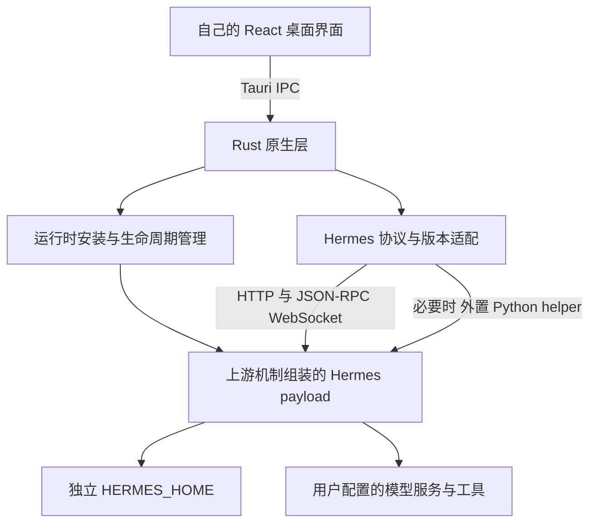

# HermessAgentDesktop 桌面端迭代方案

版本：草案 v1.3（复用本机运行环境）  
日期：2026-10-24  
状态：设计方案；I0 已启动，实际进度见 `docs/I0-implementation.md`  
目标平台：Windows、macOS、Linux

实施说明：本文最初仅讨论方案；用户已于 2026-10-24 明确授权开始开发。I0–I6 仍是分阶段计划，完成状态以实施记录和验收结果为准。

本版主要调整：补齐进程与发现隔离、优先复用上游运行时封装、按安装格式区分桌面升级；首版只提供应用安装位置和主要存储位置选择，自动搬迁、已有 Hermes 数据导入与分目录高级配置均延后。

v1.3 补充：优先检测并复用本机兼容的 Python、Node；不存在、版本不兼容或健康检查失败时，按需下载到产品主要存储位置。复用系统解释器不等于复用全局依赖或既有 Hermes 安装；默认在线引导包与完整离线包分别交付。

## 1. 结论与项目目标

建议从零建立独立的 **Tauri 2 + Rust + React + TypeScript 桌面端**，将原版 `hermes-agent` 作为固定提交的外部依赖引入，通过它已有的 CLI、HTTP 和 JSON-RPC/WebSocket 接口完成集成。

核心分工：**Hermes 负责 Agent 能力与业务数据，自己的桌面端负责交互、运行时交付、原生能力和国内使用体验。**

本方案将用户所说的 `hermess-agent` 对应为本地 `cankao/hermes-agent`，将 `cndesktop` 对应为 `cankao/Hermes-CN-Desktop`。实际产品目录使用现有的 `HermessAgentDesktop/`。

项目必须达到以下目标：

1. 不采用 Electron，不要求用户手动安装 Node.js、Rust 或编译工具。
2. 用户下载对应平台安装包、配置可用模型，即可完成第一轮真实对话和工具调用。
3. `hermes-agent` 源码保持上游原样；自己的协议适配、打包、插件和 UI 全部在外部维护。
4. 安装、启动和升级不把 GitHub、公共 PyPI、npm 的实时可达性作为必要条件。
5. Windows、macOS、Linux 都有明确的安装、运行和升级验收，不能用“框架跨平台”替代产品验收。
6. 功能范围以原版 Hermes 为基准，按迭代逐步覆盖；不在第一版复制全部页面。
7. 按平台安装形式支持应用位置选择，首次启动支持选择一个主要存储位置；Windows 用户可以将主要占用放到非系统盘，升级后保留原路径。首版不提供运行中搬迁或自动迁移。
8. 兼容的本机 Python、Node 优先复用，不重复下载或全局安装；不兼容时保留用户环境，在本产品目录下载所需版本。Node 仅在启用确实需要它的能力时准备。

需要纠正一个因果判断：Electron 并不天然导致“国内不能用”；网络分发、账号依赖、模型服务、依赖下载和产品交互才是需要分别解决的问题。Tauri 可以避免随壳分发完整 Chromium，但 Python、工具依赖、资源和 WebView 前置条件依然存在，不能提前承诺整个安装包很小。

## 2. 已核实的参考项目事实

以下仅代表当前本地检出，未声称是远端最新版本。代码结构已检查，尚未启动参考项目、实测模型或构建安装包。

| 对象 | 本地证据 | 对方案的影响 |
| --- | --- | --- |
| 原版 Agent | `cankao/hermes-agent`，Git HEAD `5894e750c3dba980d43b25aa29e3958149ba2c61` | 作为第一轮兼容性研究基线，产品实施时再次确认并锁定 |
| 原版桌面端 | `apps/desktop/README.md`、`apps/desktop/electron/` | Electron 外壳负责原生能力，Agent 是独立后端；可借鉴边界，不需要重写 Agent |
| 无界面后端入口 | `hermes_cli/subcommands/dashboard.py` | 已有 `hermes serve`，支持 `--host`、`--port`，端口 0 表示由系统分配；serve 不构建或打开 Dashboard UI |
| 网关协议 | `tui_gateway/ws.py`、`apps/shared/src/gateway-contract.openrpc.json` | 有 `/api/ws` 和生成的协议描述，可按固定版本实现适配 |
| 连接恢复 | `apps/shared/src/json-rpc-gateway.ts` | 已涉及心跳、请求超时、服务端请求和事件重放；不能只实现收发文本 |
| 本地网关所有权 | `apps/desktop/electron/local-gateway.ts` | 已有 `hermes gateway ensure --json` 的发现流程、实例身份及协议版本信息 |
| 本地连接票据 | `apps/desktop/electron/local-gateway-python.ts` | 官方桌面端也使用 Python helper 调用上游内部模块；“源码不改”不等于“接口永远稳定” |
| 用户级进程发现 | `hermes_cli/main_dashboard.py`、`gateway/host_rendezvous.py`、`gateway/status.py` | host 发现与锁按操作系统用户共享，独立 `HERMES_HOME` 不自动带来进程隔离 |
| 桌面进程身份 | `hermes_cli/process_identity.py` | `HERMES_DESKTOP=1` 还需每次启动的凭据；单一环境标志不是完整归属证明 |
| 上游运行时封装 | `scripts/build/agent.py`、`scripts/build/README.md` | 已有 prepared inputs → payload/manifest/启动器的组装流程，优先复用，不自建第二套 Python 包管理 |
| 安装归属与附加环境 | `hermes_cli/steward.py`、`pm/environments.py`、`pm/paths.py` | 安装元数据决定 bundled/更新归属，附加环境与数据根、安装路径有关，不能任意重排全部依赖 |
| Python 版本 | `pyproject.toml`、`apps/desktop/README.md` | 元数据允许范围与实际支持策略不同；当前源码说明运行支持聚焦 Python 3.14，应按固定提交的实际依赖构建，而非随意使用系统 Python |
| 上游平台边界 | `website/docs/getting-started/platform-support.md` | 有原生 Windows 路径；Linux 桌面发布在该检出的上游工作流中被禁用，自己的 Linux 交付需要自己验证 |
| CN 桌面端 | `cankao/Hermes-CN-Desktop`，Git HEAD `06e15d0e5d3c27f1fd37f09579f26f91c020036e` | 使用 Tauri 2、Rust、React，具有托管运行时、原生代理和 WS 中继等参考实现 |
| CN 后端依赖 | CN 项目 `README.md`、`AGENTS.md` | 其后端是 `Hermes-CN-Core`，不能把它的接口和扩展直接当作原版能力 |
| CN 嵌入式模式 | CN 项目 `AGENTS.md`、`src/embedded/` | 文档明确依赖 Core 的 `hermes_embedded`；不适合作为“原版不改动”的首期路线 |

参考资料存在版本描述不一致：CN 的 README、Cargo.toml、AGENTS.md 和结构技能中的版本号并非全部一致。因此不以说明文档中的旧版本、模块数和行数作为产品事实，以源码和固定提交为准。

### 2.1 借鉴范围

| 来源 | 借鉴内容 | 不直接继承的内容 |
| --- | --- | --- |
| 原版 Hermes | 会话与工具语义、配置和数据归属、网关协议、能力组织 | Electron 主进程、preload、官方分发和账号流程的硬绑定 |
| CN Desktop | Tauri 壳分层、运行时管理、诊断、国内交付思路、交互体验 | CN-Core 专有接口、品牌、更新地址、应用标识、嵌入 Python 方案 |

代码复用边界：本地 Hermes `LICENSE` 为 MIT；CN Desktop 的本地 `LICENSE` 明文标注 PolyForm Noncommercial 及商业使用另需授权。默认独立实现 CN 参考中的产品思路，不把其源码、图标、素材直接复制进本产品。若以后决定复用具体文件，再按其实际许可处理；此项不阻塞独立实现。

## 3. “引入仓库但不改动”的工程定义

### 3.1 推荐引入方式

产品仓库不使用 Git submodule。仅在明确升级时确认上游最新正式 Release，审查其 tag 和完整 commit SHA，写入 `runtime/upstream.lock.json`。本地与 CI 按锁文件把上游仓库单独克隆到忽略目录 `vendor/hermes-agent/`；日常构建不得动态选择最新版本。当前 `cankao/` 只作为研究资料，不直接作为正式运行时来源。

建议目录，均为待创建结构：

```text
HermessAgentDesktop/
├── apps/desktop/               # 自己的 React 界面
├── apps/desktop/src-tauri/     # Rust 外壳与进程管理
├── packages/protocol/          # 自己的类型、错误、能力映射
├── packages/hermes-client/     # Hermes HTTP/RPC 适配
├── adapters/python/            # 必要时使用的外置 helper
├── vendor/hermes-agent/        # 从锁定 Release tag 单独克隆的忽略目录，只读
├── runtime/                    # 各平台运行时清单，不提交密钥
├── scripts/                    # 准备、构建、验收脚本
├── tests/                      # 契约、集成与桌面验收
└── docs/                       # 决策、能力矩阵与发版说明
```

以上部分目录为规划结构；已实现的目录和流程以当前仓库为准。

### 3.2 允许与禁止

允许：

- 更新锁定的正式 Release tag 与完整提交 SHA，但必须通过兼容验收。
- 在产品目录之外的构建暂存区准备 Python 环境、安装上游依赖、生成发行资源。
- 调用该固定提交已有的构建与组装机制，在暂存区生成启动器、manifest、安装归属元数据和分发签名；生成内容单独列明，不覆盖上游受版本控制的源文件。
- 用外部环境变量、上游正式配置、CLI 或协议配置 Hermes。
- 在自己的目录编写 helper；如果调用上游内部 Python 模块，要登记依赖和对应提交。
- 通过上游扩展点编写自己的插件，并单独打包、单独启用。

禁止：

- 修改上游 Python、桌面端或配置默认值的源码。
- 构建时自动打补丁、覆盖模块、注入 monkey patch，以此伪装“没有改上游”。
- 从自己 UI 直接写上游 SQLite 数据库，或者另建一套会话数据库与上游双向同步。
- 使用未经版本、架构和健康检查的系统解释器；自动接管系统 `hermes` 或跟随上游 main。按 §4.6 验证并记录的本机 Python/Node 允许复用。

CI 检查：克隆的 tag、完整提交 SHA 和来源等于锁文件；构建前后上游 tracked 文件无差异；无意外 untracked 文件；生成物写到暂存区。发行 payload 中来自上游的源文件再与固定提交逐文件校验，避免只检查检出目录、却在暂存副本中修改源码。生成元数据、启动器和平台二进制签名单独登记来源与摘要，不能混同为源码补丁。检查失败不能发布。

### 3.3 上游没有接口时的处理顺序

1. 查固定版本的正式 HTTP/RPC 接口和 CLI。
2. 用外置适配组合现有能力；CLI 输出应采用结构化形式，避免解析面向人的文案。
3. 确实需要内部模块时，集中放入版本绑定的 Python helper，写入兼容清单并增加真实集成测试。
4. 仍无法可靠实现，则明确标记不支持或延期；需要上游修改才能实现的能力，不纳入当前版本承诺。

不为覆盖一个页面而 fork 整个 Agent 内核。

## 4. 技术架构与关键边界



### 4.1 技术选择

| 层 | 建议 | 目的与限制 |
| --- | --- | --- |
| 桌面外壳 | Tauri 2 + Rust | 窗口、托盘、文件选择、通知、生命周期与更新 |
| 前端 | React + TypeScript + Vite | 与两个参考项目技术背景一致，便于理解协议和交互；自己实现页面 |
| 状态 | TanStack Query + 小范围 Jotai | 请求缓存与实时界面状态分开，会话事实仍归 Hermes |
| 协议 | HTTP + JSON-RPC/WebSocket | 复用上游真实能力，不嵌入 Dashboard 页面作为最终产品 |
| Agent | 固定提交的原版 Hermes | 不 fork 内核，不重新实现工具调度和记忆逻辑 |
| Python 与依赖 | 本机兼容解释器优先，缺失时托管下载；复用上游 PM/组装机制 | 发行清单规定兼容范围，依赖隔离；不要求用户预先安装，不自研依赖解析 |
| 首期集成模式 | 独立后端进程 | 与解释器、平台和异步任务隔离，崩溃可诊断 |
| 产品包管理 | pnpm + Cargo；Python 按上游锁定策略 | 三类依赖分别锁定，发布不临时解析最新版 |

Tauri 在 Windows 使用 WebView2，在 macOS 使用 WKWebView，在 Linux 使用 WebKitGTK。跨平台 CSS、附件、媒体、输入法和 WebSocket 行为需要实机验证。[Tauri 官方 WebView 说明](https://v2.tauri.app/reference/webview-versions/)

### 4.2 连接与进程管理

连接适配器必须同时覆盖“发现、身份、鉴权、协议”。本产品默认拥有自己的本地后端，不自动连接、重启或接管系统已有 Hermes。独立 `HERMES_HOME` 只隔离数据，不能单独作为进程隔离依据。

**I0 必须固化的启动契约：**

| 项目 | 设计要求 | 验证方式 |
| --- | --- | --- |
| 程序来源 | 从已验证的本机工具记录或托管 manifest 解析绝对解释器路径；依赖与 Hermes 入口始终属于本产品；不在运行时重新按 PATH 猜测 | 多版本 Python/Node 或其他 Hermes 在 PATH 中时仍使用记录的组合 |
| 数据范围 | 子进程启动前设置本产品 `HERMES_HOME`，Profile 派生仍在该根内；不修改系统 HOME 冒充隔离 | 与已有 CLI 的配置、历史、Profiles 不互相出现 |
| 发现与锁范围 | 在本产品私有目录使用上游已有 `HERMES_GATEWAY_LOCK_DIR`；直接 serve 路线验证 `--isolated`，避免用户级 host 附着和命名 Profile 重路由 | 同一 OS 用户已有官方 CLI/桌面端时可并行启动 |
| 桌面身份与鉴权 | 对齐固定提交的桌面归属流程：当前代码要求 `HERMES_DESKTOP=1` 配合每次启动凭据等完整条件；令牌不传给终端或工具子进程 | 身份判断、HTTP/WS 鉴权、凭据泄漏负例均验证 |
| 网络监听 | 仅 loopback，随机可用端口；使用上游就绪文件/就绪标记取得实际端点，再验证身份 | 端口变化、端口被其他程序复用时不误连 |
| 进程归属 | 记录 PID、进程创建身份、运行时路径和启动代次；退出只操作已证明属于本产品的进程 | 外部实例不受关闭、修复、升级影响 |

上表是待验证的设计契约，不是已执行的启动脚本；具体凭据名称、就绪字段、Profile 路由和锁目录权限以固定提交的真实实现登记到 ADR。首选验证专用 `serve` 后端路线；`gateway ensure --json` 仅在同样满足私有发现范围和可控生命周期时作为候选，不能无范围地附着已有 owner。I0 选定唯一默认路径，首版不维护多套自动猜测与静默回退。

连接实现要求：

- 根据最终路径验证 `instance_id`、`authority_epoch`、`runtime_protocol` 等实际适用字段，或该路径对应的启动身份，不能只探测端口可连接。
- 外部 Python helper 放在自己的目录，使用与后端同一已验证解释器和应用依赖环境；调用内部模块时锁定提交并测试。票据只在必要的原生侧流转，不进入日志。
- Rust 统一代理本地 HTTP/WS，通过有界队列和输出合并向 UI 发送事件；不改变上游 RPC 与服务端请求语义。
- 前端接收能力列表、连接状态、审批/澄清请求和错误；不接触启动凭据。对写操作不盲目重试，断线后先恢复状态，避免重复任务。
- 状态至少包括：未准备、准备中、启动中、鉴权中、就绪、恢复中、失败、升级中、停止中。每个失败都给出阶段与可操作的恢复入口。

自己的应用做单实例控制；第二次启动聚焦现有窗口，不再产生同数据目录的写入者。PID 重用、重复点击启动、旧后端残留、父进程崩溃和睡眠唤醒均须验证。

Windows Job Object、Unix 进程组与上游已有子进程管理协作，不能将合法后台 owner 当普通子进程误杀，也不能在未知归属时按进程名批量结束。关闭窗口默认隐藏到托盘；无托盘环境提供明确的继续运行/退出行为。明确退出等待或由用户停止活动任务，然后停止本产品拥有的后端；独立系统后台服务不属于首版。

### 4.3 数据与密钥

- 安装资源、可更新运行时、用户数据分目录；安装目录只读可运行。
- 会话、记忆、Skills、Profiles 和业务配置由 Hermes 持有；桌面端只保存窗口、主题、最近工作区等界面状态。
- 默认独立数据目录，支持中文与空格路径。日志输出与文件统一 UTF-8。
- 首版使用新建的独立数据根，不自动采用或导入已有 `~/.hermes`；发现既有安装只说明数据独立。已有数据导入、存储搬迁与自动迁移纳入后续范围，源目录保持不动。
- 密钥优先通过上游配置流程写入上游需要的位置；桌面端连接凭据使用系统凭据存储。若上游需要 `.env`，如实说明它的存储形式，限制目录权限并脱敏日志，不宣称系统钥匙串覆盖了所有密钥。
- 首期避免绕过服务端写配置文件；确实无接口时，按配置语义保留未知字段、原子写入，并明确是否重启或仅对新会话生效。

### 4.4 安装位置与存储位置

首版只向用户暴露两个位置，避免把上游依赖目录全部变成可配置项：

| 位置 | 保存内容 | 选择时机 | 首版变更边界 |
| --- | --- | --- | --- |
| 应用安装位置 | Tauri 程序、前端、引导资源；完整离线版另含离线依赖包 | 按平台安装形式选择 | 不提供应用内搬家；重新安装保留数据，替换路径按平台验收 |
| 主要存储位置 | 本产品拥有的基础运行时版本、完整 Hermes 数据根、更新暂存和备份 | 首次启动，在初始化后端前选择 | 初始化完成后不提供自动修改或搬迁；设置中只查看和打开目录 |

项目工作目录另行选择，用于 Agent 处理项目文件，不等同于以上两个位置。

主要存储位置示例（产品自有布局草案，不代表已经实现）：

```text
用户选择的主要存储根/
└── HermessAgentDesktop/        # 产品专用子目录，避免接管整个磁盘或用户父目录
    ├── runtimes/<id>/          # 校验通过的基础 payload，按 manifest 定位内部结构
    ├── hermes-home/            # HERMES_HOME；上游附加环境、tools、缓存按其规则放置
    ├── control/                # 本产品私有发现锁、启动就绪文件与状态
    ├── updates/                # 更新暂存与事务记录
    └── backups/                # 升级前一致性备份
```

上游的附加环境可能位于 `hermes-home/installs/`，工具与缓存也可能位于数据根内。首版保留这种语义，不强制把所有依赖移到 `runtimes/`；不承诺运行时、数据、缓存可以分别选盘。日志实际位置遵守各层规则，界面汇总占用即可。

**平台行为：**

- **Windows**：NSIS 提供应用目录选择，例如 `D:\Apps\HermessAgentDesktop`。首版固定当前用户安装模式，只允许当前用户可写的目录；不可写时提示重新选择，不自动切换成管理员安装，不支持所有用户安装模式。首次启动允许选择 D 盘等本地存储根，最终实际路径先展示再确认。安装范围、注册信息、应用标识与更新方式保持一致。
- **macOS**：采用 DMG 放置 `.app`，推荐 `/Applications` 并验证 `~/Applications`；主要存储位置单独选择。运行时和数据不写入已签名的 `.app`。应用替换无权限时保留原程序并提示手动安装新版，不把“可启动”视为“任意位置都可自动更新”。
- **Linux**：AppImage 文件可放在用户选择的本地位置；deb 遵循包管理器的系统目录，不承诺任意安装前缀。两种形式都可选择主要存储位置，不能混用二者的桌面更新路径。

平台安装形式参考 [Tauri Windows 安装器说明](https://v2.tauri.app/distribute/windows-installer/)、[DMG 说明](https://v2.tauri.app/distribute/dmg/)和 [AppImage 说明](https://v2.tauri.app/distribute/appimage/)。目录初始化、路径保持和卸载数据策略由本产品实现并验收。

**路径与配置规则：**

1. 初始化前检查规范化后的绝对路径、可写/可执行权限、目录归属与本地控制鉴权所需权限、空间和既有内容；不能只做一次“创建文件成功”测试。Windows 验证 ACL，POSIX 验证归属与权限；不能通过关闭上游检查放行。
2. 应用目录与产品实际存储子目录不得重叠或互相包含。首版正式支持本地固定磁盘，覆盖中文、空格、非系统盘；网络共享、移动盘、云同步目录和超长路径不纳入正式支持范围，识别到时说明限制。符号链接/目录联接必须按解析后的实际目标检查；无法证明安全边界时拒绝初始化。
3. 只初始化空的产品专用目录。发现本产品已有目录时仅允许恢复同一实例的已记录位置并校验身份；发现其他实例或未知数据则拒绝合并、覆盖或接管。
4. 系统标准用户配置位置保留小型定位文件，记录存储根、实例 ID、当前发行组合与格式版本；系统 WebView、凭据存储和必要系统临时文件仍按系统规则管理，不承诺系统盘零写入。
5. 先保存并确认存储位置，再初始化运行时与后端；初始化中断按状态记录继续或清理本次暂存，不改用默认目录。重启及升级读取既有定位信息，找不到原磁盘时阻止后端启动，提供重新查找原位置的恢复入口，不能静默生成空历史。
6. 所有进程使用绝对路径和参数数组；不依赖工作目录、不拼接 shell 命令处理路径。只在子进程范围设置上游已支持的变量，不修改用户系统环境。
7. 卸载默认保留主要存储目录与定位信息。用户主动选择清除时，核验产品标记与实例身份，只删除本产品拥有的内容；不递归删除所选父目录。自定义路径不会被框架默认卸载逻辑自动正确清理，须单独验收。

**首版验收：**

- Windows 应用安装到 D 盘中文空格目录，主要存储位置另选本地目录，完成真实任务、重启和安装器升级；两处位置均保持不变。
- macOS 两种推荐应用位置均完成启动及对应更新/手动更新恢复验证，主要存储位置保持不变。
- Linux AppImage 从自选位置运行，deb 按系统路径安装，两者均验证自选主要存储位置和各自升级方式。
- 覆盖无权限、权限不符合上游要求、空间不足、磁盘不可用、目录冲突、初始化中断和重复启动；失败不覆盖原数据。
- I0 验证路径与进程契约，I1 建立位置选择和恢复定位，I3 验收安装、升级与卸载。首版验收不包含自动搬迁。

**后续范围：** 设置中迁移主要存储位置、独立选择多个存储目录、导入已有 Hermes 数据。后续另行设计带事务记录的“停写—备份—目标重建—校验—切换—恢复”流程；Python 虚拟环境不视为可直接复制搬迁，上游按路径生成的安装标识和附加环境需重新验证。首版不提供按钮或脚本暗示这些能力已经可用。

### 4.5 运行时封装与源码完整性

优先使用固定提交已有的 PM 环境准备与 `scripts.build.agent` 组装机制。发行资源的构建和签名发生在开发/CI 暂存区；普通用户首次启动检测本机工具、取得缺失资源、准备隔离依赖环境并初始化，不编译或修改 Hermes 源码。

本节 contained payload 用于托管解释器路线。复用本机 Python 的路线按 §4.6 使用该解释器准备产品独立依赖环境，不能强制再安装 contained payload 中的第二套 Python。首次启动允许使用上游机制从固定 wheel/依赖包创建环境；这属于依赖环境准备，不是修改或编译 Hermes 源码，缺少所需预编译依赖时应报告兼容缺口而不是要求用户临时安装编译器。

**构建链路：** 固定源码与锁文件 → 为目标 OS/架构准备解释器包、应用依赖、独立 PM runtime、基础工具与资源 → 生成托管 payload 及可供本机解释器路线使用的固定依赖包 → 检查源码与 manifest → 对分发二进制签名并刷新相关摘要 → 生成产品发行清单 → 发布国内资源并生成在线/离线安装产物。

- 复用上游组装器产生启动器、相对路径映射与 manifest，不把开发机的普通 venv 直接压缩后当作可搬运发行包。contained 布局是否可在自选目录运行，必须实机验收。
- 将安装归属、bundled 标记、PM runtime 和可写扩展存储作为同一封装契约；具体 stamp 字段必须按固定提交验证，不凭字段名称伪造元数据。产品发行清单与上游 manifest 分开管理，不能假设上游 stamp 自动识别 Tauri 的更新方式。
- 明确更新所有者是本产品。上游自行更新不能改变固定代码或版本配对；使用其 sealed install/安装归属机制验证 CLI、RPC 和插件触发的更新行为。若原样源码无法满足这一约束，应阻塞该发行方案，不能注入补丁或只隐藏界面按钮。
- 首轮聊天、serve 服务、一个基础工具和审批所需的解释器来源、应用依赖与 PM 启动依赖完整列入资源清单。在线版首次准备阶段只下载缺失资源；完成后，触发基础工具和重启不能再偷偷在线补装核心。完整离线版预置这些资源，仍优先复用本机兼容工具。第三方插件、浏览器和语音等另列可选依赖。
- 记录各能力是否需要 Git、Shell、Node、浏览器和系统库。Windows 基础终端路径明确提供所需 Shell；Git 等工具是否随包及 POSIX 缺失时的行为在 I0 锁定。缺少可选工具就报告对应能力不可用，不要求用户为了基础对话安装编译工具。
- 可选依赖通过上游 PM/扩展机制管理，产品负责引导与可达来源，不再实现一套依赖解析和环境选择。启用前检测额外下载来源，不能承诺任意插件均可离线安装。
- 首次初始化与更新均先落入唯一暂存目录，成功标记最后写入；只有完整校验通过的 payload 才能成为活动运行时。组装器完成 manifest 不等于原生启动或签名验收通过。

I0 输出封装 ADR、最小依赖/资源表和一个原生样机；I3 必须在所有首版架构的干净机器上验证离线初始化、实际工具调用与安装包签名。不改上游源码是硬约束，不能为了补齐封装绕过它。

### 4.6 本机 Python / Node 检测、复用与按需下载

**默认策略：已验证且仍可用的已选工具 → 首次选择时优先本机兼容工具 → 本产品已下载的兼容缓存 → 下载缺失的托管版本。** 已经完成选择后不因 PATH 顺序变化而自动改换解释器。Python 是否存在与应用依赖是否齐全分开判断；有 Python 不代表已经装好 Hermes 所需包。

| 检测结果 | 产品行为 |
| --- | --- |
| 存在兼容 Python | 直接引用本机基础解释器，在主要存储位置创建隔离的产品依赖环境；不重复下载完整解释器、不向全局 site-packages 安装包 |
| Python 缺失、版本/架构不匹配或不可用 | 说明检测原因，自动下载清单指定的托管版本到主要存储位置；不覆盖、不升级用户已有 Python |
| 所需能力存在兼容 Node | 引用其已解析的绝对路径；按该能力实际需求检测 npm/npx 等配套命令 |
| 所需能力缺少兼容 Node 或配套命令 | 下载并准备兼容的产品托管工具包，保留用户安装；只补齐缺失组件，不因缺少 npm 就把可用 Node 简单视为完全不存在 |
| 未启用依赖 Node 的能力 | 不为 Tauri 前端渲染安装 Node；仅在基础能力或 MCP/工具确实需要时检测并准备 |

检测包括实现/版本、OS/CPU 架构与位数、真实可执行路径、基础启动和所需模块/环境创建能力；Node 另外检测实际功能需要的命令与原生模块 ABI。兼容范围由发行清单列出测试通过的组合，不能简单使用“版本越新越好”或只凭 `--version` 成功。当前上游 Python 元数据范围较宽，实际运行要求需依固定提交验证，不能有 Python 3.x 就直接采用。

检测入口覆盖系统登记、平台常见位置和 PATH，并允许用户选择已有可执行文件。Windows 处理多版本启动器和商店别名；macOS/Linux GUI 不假设继承交互式 shell PATH。所有候选均通过超时受控的原生进程探测，记录解析后的绝对路径；不启动用户 shell 配置脚本来猜环境。

Python 复用只借用基础解释器，应用依赖仍通过上游 PM/构建机制按锁文件准备，默认不继承全局 site-packages。不执行系统级 `pip install`，不改全局 npm 包、系统 PATH、默认 Python/Node 或用户 shell 配置；Node 工具依赖使用产品/项目独立目录。[Python venv 隔离说明](https://docs.python.org/3.14/library/venv.html)、[Node 运行时版本信息](https://nodejs.org/api/process.html#processversions)

必须在 I0 验证上游 PM、启动器和工具调用链实际使用选定解释器/Node，而不是 UI 宣称复用、后台仍下载一套。具体输入、manifest/stamp 与环境传递方式集中到外置适配，不能改上游源码或覆盖其模块；若某能力要求专用工具版本，界面显示该限制和所需下载。

**下载和失败规则：** 从产品已验证的国内发行源获取匹配 OS/架构的固定资源，校验签名/摘要后在主要存储位置解包，支持进度、取消、重试与缓存复用。不运行全局安装器、不申请系统提权；重试不重复下载已验证的资源。没有网络且缺少资源时，显示缺失项并允许导入对应离线包，不永久等待或擅自改用不兼容版本。

**环境变化与更新：** 记录 `system/managed` 来源、绝对路径、版本、架构、必要 ABI/健康指纹及依赖环境代次。每次启动做轻量复检；系统工具被卸载、替换或升级后，停止使用失效组合，先尝试兼容的已有候选/缓存，否则提示并按需下载。切换 Python 后重建产品依赖环境并验证，数据根不搬迁；切换中断按运行时修复事务恢复。不能承诺依赖已删除的系统解释器仍能回退，须准备可下载/离线导入的匹配托管包。

设置显示“正在复用哪个 Python/Node”“为何需要下载”“将下载到哪里”，提供重新检测和选择已有工具入口；不强制用户学习包管理器。卸载只清理本产品拥有的环境和下载资源，不删除引用的本机 Python/Node。

首版验收至少覆盖：有兼容 Python/Node 且无重复解释器下载；只有 Python；只有 Node；两者都没有；版本过旧/架构不符；多个版本；npm 缺失；中文路径；系统工具被卸载或升级；下载中断；首次准备完成后的离线重启。复用与托管两条路线都必须验证原版源码不变、依赖隔离、主要存储位置保持和已有 Hermes 共存。

## 5. 功能范围和优先级

“功能参考 Hermes”指同一能力来源与语义，不代表默认开放所有工具，也不代表一次做完全部功能。

| 能力 | 优先级 / 迭代 | 交付行为 | 接入原则 |
| --- | --- | --- | --- |
| 首次启动与模型配置 | P0 / I1–I2 | 中文引导、连通性检查、首条真实消息 | 上游配置与模型接口；不绑定官方账号 |
| 聊天与会话 | P0 / I1–I2 | 新建、切换、历史、流式输出、停止、失败重试 | RPC 与事件；逐项登记实际方法名 |
| 工具与用户交互 | P0 / I2 | 工具输入输出、执行进度、批准/拒绝、澄清问题 | 处理服务端请求，不能只展示消息事件 |
| 文件与附件 | P0 / I2 | 文件选择、拖入、上传、路径确认、基础预览 | 原生选择 + 上游支持的附件协议 |
| 运行时与诊断 | P0 / I0–I3 | 本机 Python/Node 检测复用、缺失下载、健康检查、修复、日志导出 | 按 §4.6 选择来源，依赖仍隔离 |
| 安装与主要存储位置 | P0 / I0–I3 | 首次选择、查看实际位置、重启及升级保持 | 遵循安装格式，不含自动搬迁 |
| 桌面与运行时更新 | P0 / I3，I6 完整演练 | 按格式更新、配对准入、备份与失败恢复 | 只有验证通过的组合可以启动后端 |
| 国内模型与自定义端点 | P0 / I2–I3 | Base URL、Key、模型标识、测试与错误说明 | 以该上游版本支持的 provider 为准；兼容端点不等于全部能力兼容 |
| Skills / MCP / 工具 | P1 / I4 | 查看、配置、启停、依赖状态 | 上游接口/CLI；第三方依赖单独检测 |
| Memory / 人格配置 | P1 / I4 | 查看编辑、提示生效范围、备份 | 尊重上游会话缓存语义，不擅自热改进行中的系统提示 |
| 定时任务 | P1 / I4 | 创建、暂停、运行记录、错误诊断 | 使用上游调度；不另建桌面调度器 |
| Profiles / 项目 | P1 / I4 | 切换、数据隔离、工作目录管理 | 复用上游 Profile 和项目语义 |
| IM 接入 | P2 / I5 | 优先验收一个国内平台，再扩展 | 仅对原版已支持并测通的平台提供正式引导 |
| 用量与费用 | P2 / I5 | Token 统计、可用时显示费用 | 无价格或结算数据时显示未知，不能伪造金额 |
| 子 Agent 与复杂任务 | P2 / I5 | 展示任务关系、运行状态与结果 | 复用上游，不另建任务引擎 |
| 语音 / 浏览器 / 桌面控制 | P2 / I5 后 | 按平台和工具实测逐项开放 | 不作为三平台首版默认承诺 |
| 远程 Hermes | 后续 | 单独连接配置、鉴权、能力差异 | 明确远程机器才是工具与文件执行位置 |

交互底线：启动失败不能永久转圈；任务执行与普通文本有清楚区别；停止按钮有确认后的真实状态；连接恢复后不出现重复回复；模型认证错误与网络错误分别展示；页面不能有点击后无行为的占位按钮。

## 6. 国内可用性专项

### 6.1 交付与依赖

默认发行在线引导包：先检测并复用兼容的本机 Python/Node，缺失的解释器、工具或应用依赖包从产品国内发行源下载，不重复下载已有可用组件。用户仍需取得 Hermes 自身的固定依赖，不能把“已有 Python”当作“依赖已齐全”。安装依赖使用产品隔离环境，不运行系统级 `pip install`，不临时 `git clone` 上游。

同时提供完整离线包，包含受支持目标的核心资源与解释器兜底包；即使离线包内有 Python/Node 资源，也先检测本机兼容版本，不重复解包安装。已安装产品可以导入匹配的离线资源包修复，避免重新下载安装整个应用。在线/离线资源共用发行清单，映射到同一验证过的发行组合。

可选工具依赖按能力分包：终端基础、MCP 所需 Node、浏览器组件、语音等分别登记来源、版本、架构、摘要、体积、系统要求和离线状态。缺少可选包只影响对应功能。

自己的国内发行源提供安装包、完整运行时和更新清单；使用 HTTPS、签名与摘要校验，不把任意第三方镜像当成可信更新。公共源作为手动或明确回退，不静默改成未经验证的地址。

Windows 安装器应检测 WebView2，并设计无该组件时的离线或国内可达安装路径。Linux WebKitGTK 等系统依赖需要检测与安装指引；AppImage 不等于包含全部系统依赖。

### 6.2 模型与网络

- 国内模型提供易理解的配置模板，自定义 OpenAI-compatible 端点保留；具体厂商与模型列表在 I2 现场验证后确定。
- 不强制使用某个模型聚合商，不假设用户有海外账号。
- 代理分清：模型请求、工具子进程、运行时下载、应用更新。逐项说明实际生效范围，不能只设置桌面下载代理就宣称全部代理成功。
- 错误区分 DNS/TLS、超时、401/403、429、余额不足、模型不存在与工具调用不兼容，避免全部变成“网络异常”。
- 对海外网站的访问能力取决于用户网络；产品不能把国内下载安装可用宣传成所有第三方网站都可达。

国内验收场景：屏蔽 GitHub、公共 PyPI 和 npm，仅开放产品发行源及测试模型端点；分别覆盖本机工具复用和缺失下载，完成安装、准备、配置、对话和一个基础工具调用。首次完全断网使用完整离线包或已具备全部资源的缓存；在线引导包缺少资源时给出离线导入入口。断网不承诺在线模型可用。

## 7. 分阶段迭代

资源假设：2 名有经验的开发者，分别主要负责 Rust/运行时和前端/协议，共同维护 CI 与测试；有 Windows、Apple Silicon Mac、Intel Mac 和 Linux 验证资源。以下为阶段范围与依赖顺序；I0 已启动，工期需在完成 I0 后依据实测重估。

### I0：原版零修改接入验证，工期在实施启动时评估

**目标：先证明集成边界成立，再投入完整 UI。**

任务：

1. 锁定上游正式 Release tag、完整提交 SHA、Python 与依赖锁，建立独立克隆、外部暂存及源文件完整性检查。
2. 优先验证 §4.2 专用 serve 契约，明确私有发现目录、启动凭据、就绪身份和退出边界；不允许默默附着现有系统 Hermes。
3. 使用上游 PM/组装机制准备最小 payload，验证安装归属、核心离线依赖和上游自更新不会改变版本配对。
   同时验证本机 Python 路线的依赖准备、PM runtime 和 Node 选择，不允许检测成功后仍偷偷下载另一套解释器；不能用托管路线通过代替本机复用要求。
4. 用最小 Tauri 界面验证 Windows x64、macOS arm64、Linux x64 的消息、流式和基础工具闭环；至少一平台完成审批、停止和断线恢复，I2 补齐全部平台。
5. 同一 OS 用户同时运行既有官方 CLI/桌面端，验证本产品启动、Profile、数据及退出隔离；验证重复启动和残留进程处理。
6. 在中文、空格和非默认存储位置运行 payload，记录附加环境实际路径、大小、权限与无公共依赖源的启动结果。
7. 明确系统最低版本、Linux 构建基线、Intel Mac 解释器/依赖可用性及平台签名前置资源；登记真实接口和内部 helper 依赖。

交付：技术样机、`upstream.lock.json`、`capability-matrix.md`、协议样本、进程与封装 ADR、依赖/资源清单、三平台结果及修订排期。当前已建立技术样机与部分记录，完成状态见 `docs/I0-implementation.md`。

验收：以上三个原生目标基础闭环成立，上游源码与发行源码一致，公共开发依赖源不可达时基础能力仍可用，自选路径和已有 Hermes 共存验证通过。Intel Mac 在本阶段确认构建输入可获得，I2 补齐完整任务，I3 完成安装包验收；不能只用交叉编译成功代替运行结果。

退出条件：若无法在不修改上游的前提下完成核心闭环，先提交具体缺口与证据并调整方案，不进入完整功能开发。

### I1：可启动的产品骨架

**目标：从技术样机变成可理解、可恢复的桌面应用。**

任务：中文主界面、会话导航、基础聊天、模型配置入口、本机工具检测与来源展示、缺失资源下载、独立依赖环境/payload 初始化、独立数据根、首次启动主要存储位置选择、带实例身份的定位文件、启动状态机、托盘/无托盘退出行为、日志脱敏与诊断。不提供自动搬迁、已有数据导入或分目录高级设置。

验收：兼容本机 Python/Node 被实际复用且不重复下载安装；干净环境自动取得必要工具，Node 无需求时不装；不修改全局包或默认命令。中文空格路径正常，能配置模型并保存历史；缺失资源可说明并修复，存储盘缺失不另建空数据；重复启动不产生多个写入者，退出不停止外部 Hermes。

### I2：日常聊天闭环

**目标：让桌面端真正比命令行和网页更方便。**

任务：会话创建/切换/历史、Markdown 和代码块、工具卡片、审批与澄清、停止、附件、基础文件预览、连接恢复、国内模型模板和自定义端点。

验收：三平台和两种 Mac 架构均完成“配置模型 → 附件 → 对话 → 工具 → 审批 → 停止 → 重启查看历史”；断连恢复不重复执行；密钥错误、模型错误和超时有对应提示；跨会话不混流。某架构未通过则登记阻塞，不能将整个首版矩阵标记完成。

里程碑：可供内部人员日常使用的 Alpha。

### I3：三平台安装与国内交付

**目标：普通用户拿到包即可使用。**

任务：Windows 当前用户 NSIS 及自选安装路径、两种 Mac 架构 DMG、Linux AppImage/deb；在线引导包与完整离线资源、WebView 前置条件、国内发行源、内外层签名、升级保留位置、备份与失败恢复。按 §9 为每种安装形式提供更新入口与可启动的恢复路径，不实现自动搬迁。

验收：每个目标安装形式在干净机器完成真实任务、更新和失败恢复；屏蔽公共依赖源后核心流程可用；损坏包拒绝启用；桌面/运行时不匹配时进入诊断而非打开数据库；macOS 完成包含内层 Python/原生库的签名、公证和安装后验证，Windows 完成签名及普通用户安装验证。

位置专项按 §4.4 验收：自选应用和主要存储位置、初始化中断恢复、升级保留目录、磁盘缺失保护和卸载保留数据均为必过项。自动搬迁不在本阶段范围；上游升级引起的数据格式变化仍按 §9 备份与恢复，不与存储搬迁混淆。

签名证书、Apple 账号和发行存储是发版前置资源；未准备好时可以交付明确标记的内测包，不能称为正式可分发版本。

里程碑：基础功能具备三平台内测交付条件。此时就有可安装产品，不必等待全部高级功能完成。

### I4：Hermes 核心管理能力

**目标：覆盖最常用的 Agent 管理场景。**

任务：Skills、MCP、工具配置、Memory、人格、Profiles、项目目录、定时任务及依赖诊断；完整覆盖批准/拒绝和配置生效边界。已有外部 Hermes 数据导入仍列为后续独立需求，不因管理功能加入而默认实现。

验收：按能力矩阵逐项跑真实后端；Profile 间数据隔离；MCP 缺少 Node 或其他依赖时可修复；记忆和 Skills 的变更符合上游会话缓存语义；切换 Profile 不丢配置。

定时任务必须显示调度器运行状态。隐藏到托盘、明确退出、系统睡眠后的行为分别验证；退出后停止调度就如实显示，不能伪装成系统后台服务已部署。

里程碑：功能完整度可供外部小范围 Beta 验证。

### I5：扩展体验与稳定性

任务：优先完成一个原版支持的国内 IM 平台接入、用量统计和子 Agent 状态；完善大历史性能、附件限制、诊断导出、恢复动作、键盘交互。语音、浏览器和桌面控制仅在基础目标达成后按需加入，不要求全部塞入该工期。

验收：连续使用与异常注入无已知阻塞缺陷；长流输出、睡眠唤醒、网络波动、磁盘不足、路径变化均有可解释的结果；扩展工具不影响基础聊天启动。

### I6：升级兼容与正式发布

任务：对 I3 已建立的按安装格式更新、桌面/运行时/数据兼容与恢复机制进行完整演练，补齐灰度、第三方声明、发行说明和问题反馈入口；不能把基础升级设计拖到本阶段才开始。

验收：使用一对经过审查的真实上游提交，完成升级与失败回退演练；关键配置和历史可恢复；每个发布平台都有实测安装和升级结果；清单能追溯桌面版本、上游 SHA、Python、依赖锁和产物摘要。

正式版本只发布验收通过的组合，不允许在桌面端打开时自动追踪上游 main。

### 7.1 排期判断

v1.0/v1.1 曾按 I0–I6 合计 39–58 个工作日、含缓冲约 10–15 周做初步预算。该数字未充分覆盖本次复核补齐的用户级进程隔离、上游封装适配和多安装格式升级恢复，**本版不再把旧总数作为当前排期**。

I0 的原 3–5 天估计撤回，在用户明确开始实施、确认验证设备和 CI 资源后评估；I1–I6 旧阶段天数同样撤回，均须依据 I0 结果重估。自动搬迁已剔除，不在首版预算内。不在缺少运行数据时另造一个看似准确的总工期。

如果只有一名开发者，按实际吞吐和平台资源重新估算。若需要压缩首版，先交付 I0–I3，但保留三平台、两种 Mac 架构、自选位置、基本升级恢复与上游零修改约束，减少高级功能。

## 8. 平台交付矩阵

以下是产品目标，不是已经通过验证的兼容承诺。最低系统版本在 I0 根据 Tauri、上游 Python 和原生依赖联合确定，I3 固化到发行文档。

| 平台 | 首版架构 | 安装包目标 | 核心验证 |
| --- | --- | --- | --- |
| Windows | x64 | 当前用户 NSIS 安装器 | 普通用户可写安装位置、WebView2、中文路径、ACL、进程隔离、签名及原位置升级 |
| macOS | arm64 | DMG；更新使用已签名应用归档 | 内层解释器/库与外层应用签名公证、自选存储、两种推荐应用位置的替换权限、输入法 |
| macOS | x64 / Intel | 独立 DMG 与对应更新归档 | 原生解释器、wheel、签名、冷启动、完整任务、升级恢复 |
| Linux | x64 | AppImage + deb，分别验收 | 候选 Ubuntu 22.04/24.04、glibc/WebKitGTK、X11/Wayland、无托盘降级、密钥存储及两种更新所有权 |

Windows arm64、Linux arm64、更多 Linux 发行版是后续扩展；第一版不承诺所有 CPU 与所有发行版。macOS 的两种架构不能只用交叉编译成功替代运行验收。

三平台在对应操作系统的 CI runner 构建原生依赖；不假设一台 Windows 主机能完成全部签名和产物验证。Tauri 的安装包类型与签名流程以[官方分发文档](https://v2.tauri.app/distribute/)为依据，再结合实际应用依赖验收。

Linux 以最终决定支持的最老可用系统作为构建基线，候选为 Ubuntu 22.04；同时检查 Rust 产物、Python 和所有原生依赖的 ABI，不仅检查 Tauri 壳。不能在较新系统构建后凭空承诺较老 glibc 可用；AppImage 的系统库和执行条件也要在干净机器验证。[Tauri AppImage 构建限制](https://v2.tauri.app/distribute/appimage/#limitations)

macOS 对基础 payload 中的 Python 可执行文件、动态库和其他原生工具执行适用的签名检查，先处理内层再封装外层；最终清单记录签名后的摘要。将 payload 初始化到主要存储位置后再次验证加载、原生依赖和系统权限，不把 Tauri 应用签名成功视为整个运行时已验收。[Tauri macOS 签名说明](https://v2.tauri.app/distribute/sign/macos/)

本机复用的 Python/Node 不由本产品重新签名、复制覆盖或修补；只校验其实际可用性及与固定依赖的组合。产品签名责任覆盖自己分发的工具与依赖，复用路线同样需要真实安装与运行验收。

I0 形成工具依赖矩阵：各平台的基础终端解释器、Git、Node 与可选工具分别标记为“本机可复用”“托管下载/离线包兜底”或“明确的系统前置”。Python/Node 按 §4.6 执行，不能把用户预装作为强制前提。缺少系统 Git 可以影响 Git 能力，不能影响基础对话；产品不以“所有工具都能运行”替代具体能力承诺。

## 9. 版本、升级与数据恢复

### 9.1 三种版本与发行配对

| 对象 | 内容 | 更新所有者 |
| --- | --- | --- |
| 桌面程序 | Tauri 壳、前端、适配器与基础离线资源 | 按安装形式由本产品安装器/更新器或系统包管理器替换 |
| Hermes 运行时 | 固定上游源码、已验证来源的 Python、隔离依赖、PM runtime 与资源 | 本产品管理配对与托管部分；被引用的系统工具仍由用户管理，上游源码不自行更新 |
| 用户数据 | 配置、会话、Profiles、记忆、Skills 等 | 上游执行业务格式变更，本产品负责升级前备份及失败恢复 |

每份产品发行清单至少记录：发行组合 ID、桌面版本及恢复组件格式版本、上游完整 SHA、受支持 Python/Node 组合及托管兜底版本、依赖锁摘要、OS/架构/安装形式、适配版本、基础 payload/依赖包 ID、最低可读/可升级的版本范围、产物摘要与签名。每次本地激活另外记录实际采用的工具来源、绝对路径、版本、架构和依赖环境代次。数据格式若上游没有可靠版本号，则按“已验证的旧发行组合 → 新组合”登记兼容边，不虚构通用 schema 版本；不能只回退基础 Python。

第一版仅激活整套验证过的桌面/运行时组合，不开放任意混搭。桌面启动先读取定位与升级状态，再判断兼容性；不兼容时只展示诊断/恢复界面，不启动后端读取或迁移数据库。独立 runtime 包可以参与修复和暂存，但正式启用同样受配对清单约束。

本机解释器的复用属于清单允许的来源变化，不放宽依赖锁和上游 SHA。更新时先复检已有工具，仍兼容则复用；不兼容时只准备新组合缺少的托管资源。不替用户升级系统 Python/Node；回退时旧系统解释器若已不可用，先取得匹配的托管兜底包并重建依赖环境，再判断旧组合是否可启用。

### 9.2 按安装形式区分桌面升级

| 安装形式 | 正常更新路径 | 保持位置与失败处理 |
| --- | --- | --- |
| Windows 当前用户 NSIS | 校验签名后的同安装范围安装器，由更新流程调用；不得切换成 perMachine | 从注册信息恢复原安装目录，主要存储定位文件不重置；若安装损坏，使用保留的签名完整安装器修复桌面程序，再恢复发行配对 |
| macOS DMG 安装的 `.app` | DMG 用于初装/手动重装，自动更新使用已签名的应用 bundle 归档 | 替换当前应用位置，预检权限并保留失败恢复入口；无权限时不强行替换，提示通过已验证的签名 DMG 手动更新；外部存储目录不变 |
| Linux AppImage | 校验后替换当前 AppImage，或明确引导用户使用签名/摘要校验通过的新文件 | 同文件系统暂存和替换，验证可执行权限；保存已验证旧文件或提供完整修复包；无权限时走手动替换，存储目录不变 |
| Linux deb | 由系统包管理方式安装新版 deb；首版可提供下载包与明确安装指引，不要求先建设 apt 仓库 | 应用不能直接覆盖包管理器拥有的文件，不使用 AppImage 更新路径；安装后仍读取原用户存储定位，包脚本不以 root 启动用户后端或迁移其数据库 |

Tauri 提供的更新产物按 Windows 安装器、macOS 应用归档和 Linux AppImage 区分，不能据此推断 deb 自动更新已实现。[Tauri Updater 说明](https://v2.tauri.app/plugin/updater/)

应用标识、安装范围、路径定位与更新通道在首版前固定。手动下载安装、自动更新和修复安装必须遵守同一版本准入检查；发生降级时，不允许旧后端直接打开可能已升级的数据。

首版手动更新指引要求先退出本产品，确认其后端停止，再替换应用或安装 deb，不在包管理器脚本中跨用户终止所有 Hermes。若用户绕过 UI 更新，新的桌面壳发现实际版本与最后确认组合不同、且没有已有事务时，也必须先建立升级记录、确认无写入者并完成备份准入，再启动后端。不能假设每次系统包替换之前都会运行应用内更新逻辑。

### 9.3 升级事务与中断恢复

桌面替换、运行时启用和数据库变更不能假装成一个跨系统原子操作。产品在主要存储位置保留独立、持久化的升级事务记录；系统小型定位文件只指向当前存储根和最后确认的发行组合，不包含密钥。

流程：

1. 读取兼容矩阵、检查当前安装形式和磁盘空间；解析完整新组合并复检已选本机工具/缓存，只下载缺失或需更新的资源，全部校验后才允许继续；分别考虑应用盘和存储盘的暂存空间。此时不触碰活动运行时和业务数据。
2. 暂停新任务，等待或由用户停止活动任务；记录旧组合、旧附加环境代次与目标组合。只停止自己拥有的后端，并证明没有其他写入者；无法证明则拒绝升级。
3. 使用上游一致性备份能力或停进程后的完整数据副本制作升级前备份，记录校验结果。运行中的 SQLite 不能只复制单个 `.db`；备份与恢复保留完整数据及所需状态。
4. 准备新 payload 并完成不触碰真实业务数据库的启动前检查。桌面更新按 §9.2 执行，记录“已准备/替换待确认/新组合验证中”等阶段；不能在操作完成前写成功标记。
5. 新桌面先进入恢复控制流程，校验事务、运行时和数据准入，再启动新后端。上游若进行格式变更，记录此阶段已经触碰数据，不允许此后直接切回旧程序冒险读取。
6. 完成鉴权、健康检查、配置和历史读取验证后，确认活动组合。测试环境再用真实任务验证升级结果；不在用户环境自动发送收费模型请求充当健康检查。
7. 保留上一套已验证组合、升级前备份及恢复说明，确认新版本稳定后按明确保留策略清理；不在第一次启动成功时立即删掉恢复材料。

事务写入使用临时文件、原子替换和适用的持久化操作；重启后检查记录及实际文件，不只相信最后一个状态字符串。I3 验证下载、解包、备份、应用替换、数据变更及确认前的中断；不能等 I6 才补恢复设计。

### 9.4 三类失败与恢复

| 失败阶段 | 恢复规则 |
| --- | --- |
| 下载/校验/准备失败，活动组合未变 | 清理本次暂存或允许续传，继续旧组合；数据不变 |
| 桌面已替换或运行时待启用，数据未变 | 新桌面的恢复界面选择兼容组合；桌面本身无法启动时，通过对应平台的签名完整修复包恢复可运行壳，再读取事务；不承诺所有安装格式都能自动撤销包替换 |
| 新后端已修改用户数据 | 保留失败现场，停止所有写入者；只在验证旧组合可读或恢复升级前备份后才启动旧后端。已有升级后新增数据时先另存并说明恢复损失，由用户选择，不静默覆盖 |

**桌面恢复、运行时回退、数据恢复分别验收。** 上一套基础运行时存在，不等于旧附加依赖和数据库仍兼容；系统包管理器完成替换，也不等于整个发行组合已确认成功。

首版不提供“设置中自动搬迁存储”。本节的数据格式升级/恢复属于安全更新所必需的能力，与把主要存储目录从一个磁盘搬到另一个磁盘是两件事。

## 10. 测试与验收方法

### 10.1 验证层次

| 层次 | 验证内容 | 能证明什么 |
| --- | --- | --- |
| 契约测试 | 请求、响应、事件、鉴权错误、能力缺失 | 自己的适配符合固定版本协议 |
| 真实集成测试 | 原版后端 + 临时数据目录 + 本地假模型 | 真实 Hermes 调用链、工具与会话流程可重复验证 |
| 真实模型冒烟 | 至少两个独立模型端点，各覆盖流式、工具调用、错误 | 该端点实测兼容，不能用假模型代替 |
| 前端测试 | 状态转换、审批交互、错误恢复 | UI 行为正确 |
| 桌面安装测试 | 各 OS 真实安装包与 WebView | 安装、进程、文件、代理、托盘等原生路径可用 |
| 共存与封装测试 | 已有 Hermes 并行运行、重复启动、自选路径、真实工具首次调用 | 发现/进程/数据隔离与核心依赖离线完整性成立 |
| 网络与升级测试 | 按 NSIS/应用归档/AppImage/deb 分别覆盖手动与自动路径、断网、损坏、中断及恢复 | 每种安装形式的桌面、运行时和数据恢复均有证据 |

浏览器中的前端 E2E 不能替代 Tauri 原生测试。先验证各平台桌面自动化工具可行性；未自动化的部分保留版本化人工检查记录，不声称一套 Playwright 就覆盖三平台原生壳。

### 10.2 发布硬门槛

- 锁定 Release 检出目录与发行 payload 的上游源码零修改；生成元数据和签名步骤可追溯；版本与依赖清单匹配。
- 干净系统无开发工具也能启动核心能力。
- 兼容本机 Python/Node 被实际复用且不重复下载/全局安装；缺失或失效时可按需取得托管版本；全局包、系统默认工具与其他应用不受修改。
- 每个正式发布平台完成真实消息、工具、审批、取消、附件和历史恢复。
- 无跨会话串流、重复执行、密钥泄露和不可恢复的数据损坏。
- 首次安装及升级不强依赖公共开发依赖源。
- 运行时损坏、端口变化、鉴权过期、模型失败都有可用恢复动作。
- 安装失败、升级失败、数据恢复的结果均有证据和记录。
- 自选应用和主要存储位置按 §4.4 验收；初始化中断可恢复，升级不重置路径，卸载默认保留数据且不误删用户父目录。
- 与已有官方 CLI/桌面端共存时不串数据、不误连、不误停进程；重复启动不产生第二个写入者。
- 四种安装形式按 §9 各自通过替换与失败恢复；不兼容组合和手动降级不能直接打开数据库，桌面损坏有可用修复包。

性能目标在 I0 先记录机器、系统、冷暖启动、历史规模，再制定 I2/I5 的量化预算；测量窗口可交互、后端可用、首 token 三个不同时间，以及壳/后端总内存和运行时大小。没有实测前不写“100 MB”“秒开”等承诺。

## 11. 主要风险与取舍

| 风险 | 应对 | 阶段 |
| --- | --- | --- |
| 不改源码但内部接口变化 | 固定 SHA，私有依赖集中到 helper，升级先跑契约与真实集成 | I0、I6 |
| CN-Core 能力误当原版能力 | 按实际原版接口登记矩阵，不支持就明确显示 | 全程 |
| Python 与原生依赖跨平台差异 | 原生 CI 构建、固定架构包、核心与可选依赖拆分 | I0、I3 |
| 本地连接票据与 owner 复杂 | 优先对齐上游所有权流程，禁止自行简化为读 token 文件 | I0、I1 |
| 用户级发现误连已有 Hermes | 私有发现范围、完整启动身份、命名 Profile 与并行共存验收 | I0–I3 |
| 封装未遵守上游 PM/归属规则 | 复用组装器与 manifest，验证核心不补装和源码不自更新 | I0、I3 |
| 本机工具变更导致依赖环境失效 | 记录来源与真实路径、启动复检、隔离依赖、托管兜底；不自动升级用户工具 | I0–I3、I6 |
| 自选路径影响权限和依赖身份 | 两位置收敛、权限/目录身份预检、保留附加环境布局；自动搬迁延期 | I0–I3 |
| 三种 WebView 交互不一致 | 原生传输集中，输入法/拖拽/渲染单独实测 | I1–I3 |
| 国内源建设晚于客户端 | I3 前准备发行源与完整核心包，核心启动不临时安装 | I1–I3 |
| 更新后数据不可逆迁移 | 配对升级，冷备份，回退演练 | I3、I6 |
| 桌面替换与运行时状态不一致 | 按安装格式更新、持久化事务、启动前准入、完整修复包 | I3、I6 |
| 全量功能拖慢首版 | I0–I3 交付可用产品，I4 后补管理与扩展能力 | 全程 |

明确延期：首期不做嵌入 CPython、不 fork Agent、不直接改上游数据库、不自研模型调度、不自建 Skills 市场、不实现自己的 cron 引擎、不强推全部架构和全部工具；不做自动存储搬迁、已有 Hermes 数据导入、分目录高级位置配置、Windows 所有用户安装或应用内安装目录搬家。安全升级需要的数据备份/恢复仍是首版要求。

## 12. 第一轮实施任务清单

用户已授权开始开发。以下清单持续按实际证据更新，部分完成不代表 I0 已验收：

- [x] 在 `HermessAgentDesktop/` 初始化独立 Git 仓库与 Tauri 最小工程。
- [x] 按锁定 Release tag 单独克隆 `vendor/hermes-agent`，记录来源和 SHA；新版本兼容验收另行记录。
- [ ] 按上游 PM/组装器准备可复现 payload，登记 stamp、manifest、基础工具与资源；验证上游源码完整且不会自行更新。
- [ ] 验证本机 Python/Node 实际复用、独立依赖环境、缺失下载、离线资源导入及系统工具变化后的恢复；不重复安装可用解释器。
- [ ] 验证唯一启动契约、私有发现范围、每次启动身份及命名 Profile，完成已有 Hermes 共存与退出验证。
- [ ] 验证两个自选位置、中文空格路径、权限、初始化中断和存储缺失保护，不实现自动搬迁。
- [ ] 用最简 UI 完成消息、流式、工具、审批、停止、恢复。
- [ ] 三平台运行验证，Intel Mac 按阶段补齐；上游源码与用户原有数据均保持完整。
- [ ] 明确 NSIS、macOS 应用归档、AppImage、deb 的更新责任、配对准入、事务与恢复材料。
- [ ] 形成接口矩阵、封装与隔离 ADR、平台构建基线、兼容风险与 I1–I6 的修订排期。

只有上述结果成立，才将本方案从“设计草案”升级为“已验证的实施基线”。

## 附录：事实与证据索引

路径相对于工作区 `E:/Code/Private/HermessDesktopDesign/`。这些文件提供可追溯依据，不表示其中每个能力均已完成运行测试。

1. `cankao/hermes-agent/apps/desktop/README.md`：Electron/React/无界面后端分工，打包与运行说明。
2. `cankao/hermes-agent/hermes_cli/subcommands/dashboard.py`：serve 参数、随机端口及无界面行为。
3. `cankao/hermes-agent/apps/desktop/electron/backend-ready.ts`：后端就绪标记与冷启动超时处理。
4. `cankao/hermes-agent/apps/desktop/electron/local-gateway.ts`：发现协议、端点身份、owner 管理。
5. `cankao/hermes-agent/apps/desktop/electron/local-gateway-python.ts`：外置 Python 调用内部票据模块的参考。
6. `cankao/hermes-agent/apps/shared/src/gateway-contract.openrpc.json`：生成的网关协议描述。
7. `cankao/hermes-agent/apps/shared/src/json-rpc-gateway.ts`：连接、超时、服务端请求与事件恢复。
8. `cankao/hermes-agent/tui_gateway/ws.py`：WebSocket 传输与事件处理实现。
9. `cankao/hermes-agent/hermes_cli/web_server_memory.py`、`web_server_cron.py`、`web_server_mcp.py`：管理功能实现线索，具体路由仍需 I0 对照注册点登记。
10. `cankao/hermes-agent/pyproject.toml`：Python 元数据、依赖与许可声明。
11. `cankao/hermes-agent/website/docs/getting-started/platform-support.md`：上游平台和发行限制。
12. `cankao/hermes-agent/LICENSE`：上游许可原文。
13. `cankao/Hermes-CN-Desktop/README.md`、`Cargo.toml`、`AGENTS.md`：Tauri 选型、Core 依赖、运行时与嵌入式模式说明。
14. `cankao/Hermes-CN-Desktop/.codex/skills/project-structure/SKILL.md`：参考仓库分层导航，不以其旧版本号代替源码。
15. `cankao/Hermes-CN-Desktop/LICENSE`：参考项目对代码复用的许可声明。
16. [Tauri 官方 WebView 说明](https://v2.tauri.app/reference/webview-versions/)与[分发说明](https://v2.tauri.app/distribute/)：2026-10-24 查阅。
17. `cankao/hermes-agent/hermes_cli/main_dashboard.py`、`gateway/host_rendezvous.py`、`gateway/status.py`：用户级 host 发现、锁范围、隔离参数与可用目录覆盖机制。
18. `cankao/hermes-agent/hermes_cli/process_identity.py`、`hermes_cli/web_server_lifecycle.py`：桌面归属条件、进程身份和就绪信息。
19. `cankao/hermes-agent/scripts/build/agent.py`、`scripts/build/README.md`：外部输入组装、生成元数据、payload manifest 和启动器。
20. `cankao/hermes-agent/hermes_cli/steward.py`、`pm/environments.py`、`pm/paths.py`、`pm/runtime.py`：安装归属、按路径生成的环境身份、可写扩展与 PM runtime。
21. `cankao/hermes-agent/hermes_cli/gateway_runtime_discovery.py`、`hermes_dir_acl.py`：自选数据目录的权限、归属及 Windows ACL 处理依据。
22. `cankao/hermes-agent/apps/desktop/BUILDING.md`、`apps/desktop/scripts/mac-sign.mjs`：原版 payload 内容、平台工具差异及内层二进制签名参考；不直接沿用其 Electron 发布流程。
23. [Tauri NSIS 安装模式](https://v2.tauri.app/reference/config/#nsisinstallermode)、[NSIS 模板源码](https://github.com/tauri-apps/tauri/blob/dev/crates/tauri-bundler/src/bundle/windows/nsis/installer.nsi)、[更新插件](https://v2.tauri.app/plugin/updater/)：2026-10-24 复核时查阅；实现时锁定实际工具版本，不能依赖浮动 dev 分支作为构建输入。
24. [Tauri AppImage 限制](https://v2.tauri.app/distribute/appimage/#limitations)、[macOS 签名](https://v2.tauri.app/distribute/sign/macos/)、[Python 3.14 venv](https://docs.python.org/3.14/library/venv.html)：构建基线、签名与环境不可直接搬迁的参考；均需结合固定版本实机验收。
25. [Python 独立环境](https://docs.python.org/3.14/library/venv.html)、[Node process.versions](https://nodejs.org/api/process.html#processversions)：2026-10-24 查阅；支持检测基础版本/ABI 与隔离应用依赖，具体 Hermes/PM 接入和不重复下载行为仍需 I0 验证。
